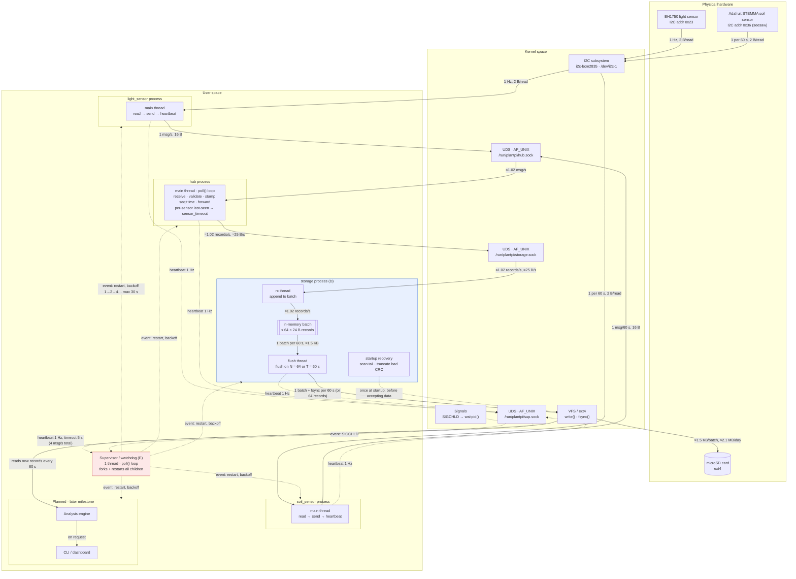

3-5 pages and the most leveraged hours of the whole project. Because every hour of arguing here saves five of rewriting later. Required contents:

## Green-Thumb Architecture Diagram

## Mechanism mapping

**Mechanism D — Custom Storage Layer**

**Choice:** an append-only log of fixed-size, checksummed records, kept in one segment file per day on the microSD (ext4). We chose it over a ring buffer or FUSE because only the log's tail can ever be damaged, which makes the crash-consistency story the simplest to state and test. **Guarantee:** *a record is committed once fsync returns; a power cut loses at most one unsynced batch (≤ 60 s) and never leaves a corrupt record readable.*

| Requirement (Green Thumb) | Mechanism | Implementing component | Justification | Measured by / target |
|---|---|---|---|---|
| Plant care needs an unbroken multi-day history | Append-only log; daily segments; 30-day retention | storage process, flush thread | Soil moisture changes over hours and watering trends over days, so the value is in the history. About 2.1 MB/day means 30 days is about 63 MB, which fits easily | 72 h soak: records committed = records sent by the hub (0 sequence gaps) |
| Keep write overhead and SD wear low | Batching: flush at N = 64 records or T = 60 s; single buffer copied out under the lock, no lock held during I/O | rx thread + flush thread | Fsyncing every record would mean about 88k fsyncs/day; batching cuts that to about 1,440/day. Soil changes slowly, so a 60 s commit delay costs nothing | Compare fsync count, write latency and CPU at (N,T) = (1, 1 s), (64, 10 s) and (64, 60 s) |
| A precise, provable durability point | fsync per batch; directory fsync when a new segment is created | flush thread | Without fsync, "written" only means the data reached the page cache. The directory fsync stops a new day's file from vanishing | Every commit logged with count and duration; report fsync p50/p99 |
| Survive being unplugged mid-write | 24 B records with CRC32; startup scan truncates at the first bad record before accepting data | storage startup recovery | A household Pi has no UPS and gets unplugged routinely. Fixed-size records make recovery a short arithmetic scan | 20 real power pulls mid-batch: 0 corrupt records accepted, loss ≤ 1 batch (60 s), recovery < 1 s |
| No loss on a normal shutdown or restart | Flush and fsync on SIGTERM | flush thread | Supervisor restarts and user shutdowns shouldn't cost a batch | 20 SIGTERM restarts: 0 records lost |
| Never fail silently | Check every write/fsync; on any detected failure, keep the batch in memory and mark storage degraded; on the next cycle, truncate to the last committed offset, rewrite and fsync | flush thread | A silent hole would undermine the history claim, which is D's selling point | Inject write/fsync errors: 100% logged as `storage_write_error` / `fsync_error` + `storage_degraded`, 0 silent losses |
| Preserve history through a storage outage | 1 MB queue (about 11 h); `storage_backlog` at 50/75/90%; when full, an explicit degraded state that refuses and counts new readings, then writes a gap record on recovery | storage process | Better a marked gap than a silent one. Storage keeps reading its socket, so the hub and sensors never block and E's heartbeats are unaffected | Outage longer than the queue (with a small test cap): 0 accepted readings lost, and the gap record's count equals the refused count |
| Restarts must not corrupt the log (D meets E) | Recovery runs before `storage.sock` accepts data | storage startup recovery + supervisor | The supervisor can kill storage at any instant, so a kill is just a power cut without the reboot | 50 random `kill -9`s on storage: 0 corrupt records |

## **Mechanism E — Splitting the System into Smaller Processes**

**Choice:** split Green Thumb into separate long-running processes for **sensor/hub communication, storage, plant-care logic, and monitoring**, with local Unix-domain sockets for communication and a supervisor responsible for restarting failed processes. We chose this over one large process because a bug or crash in one component should not stop sensor collection, destroy stored history, or take down the entire system.

**Guarantee:** *a failure in one process is contained to that process; healthy processes continue running, and the failed process can restart and reconnect without requiring a full-system restart.*

| Requirement (Green Thumb) | Mechanism | Implementing component | Justification | Measured by / target |
|---|---|---|---|---|
| One component crashing must not take down Green Thumb | Separate `hub`, `storage`, `care`, and `monitor` processes with separate address spaces | all processes + supervisor | A memory bug or unexpected failure in one component cannot directly corrupt another process's memory. The remaining services can continue doing useful work while the failed process restarts | 50 random `kill -9`s per process: only targeted process exits; all unrelated processes remain alive |
| Sensor communication must continue during failures elsewhere | Hub runs independently and communicates with other services through Unix-domain sockets | hub process | Sensor readings and heartbeats should not stop because storage, care logic, or monitoring has crashed | Kill each non-hub process for 60 s: hub remains responsive and continues receiving sensor messages |
| Failed components must recover automatically | Supervisor detects process exit and restarts it with bounded backoff | supervisor | A household appliance cannot require the user to SSH into the Pi every time a component crashes | 50 injected crashes: 100% detected and restarted; restart < 2 s under normal conditions |
| Restarts must not corrupt persistent state | Storage owns the log exclusively; other processes send requests rather than writing files directly | storage process + `storage.sock` | Giving one process ownership of persistent storage prevents multiple processes from racing over the log and keeps Mechanism D's crash-recovery rules intact | Repeatedly kill/restart hub, care, and monitor during writes: 0 corrupt log records |
| Processes must not block each other indefinitely | Unix-domain sockets with bounded queues, timeouts, and reconnect logic | IPC layer in each process | A hung or slow consumer should not freeze unrelated parts of the system. Each process can detect a failed peer and continue or enter an explicit degraded state | Freeze each consumer for 60 s: unrelated processes remain responsive; blocked operations terminate at configured timeout |
| Process restarts must not require restarting peers | Clients detect disconnect, reconnect to the recreated socket, and resume communication | IPC layer + supervisor | The supervisor may restart any process at any time, so peer processes must tolerate connections disappearing underneath them | 50 random `kill -9`s followed by restart: peers reconnect automatically with no manual intervention |
| Failures must be visible rather than silent | Each process sends a heartbeat/status message; supervisor records process exit, restart, reconnect, and degraded-state events | monitor process + supervisor | Process isolation only helps if Green Thumb can tell when part of the system is unavailable | Inject crash, hang, and disconnect faults: 100% produce process-specific failure/degraded events |
| A hung process must not remain alive forever | Heartbeat deadline; supervisor terminates and restarts a process that stops making progress | monitor + supervisor | A process can be alive at the OS level while deadlocked or stuck. Heartbeats distinguish "running" from "working" | Inject process hangs: 100% detected within heartbeat deadline and successfully restarted |
| Interfaces between processes must stay small and testable | Fixed message formats for readings, storage acknowledgments, care events, status, and heartbeats | shared IPC protocol | Small explicit interfaces reduce coupling and let each process be tested without running the complete system | Protocol tests with valid, malformed, truncated, and unknown messages: 100% malformed inputs rejected without process crash |
| Repeated failures must not create a restart storm | Exponential/bounded restart backoff and explicit persistent-degraded state after repeated failures | supervisor | If a component cannot recover, restarting it continuously wastes CPU and can interfere with healthy components | Force permanent startup failure: restart rate remains bounded; healthy processes stay responsive |
| E must work with D's crash guarantees | Storage recovery completes before `storage.sock` begins accepting new records | storage startup recovery + supervisor | From storage's perspective, a process kill is equivalent to an unexpected interruption. New data must not arrive until the existing log has been validated | 50 random storage `kill -9`s during active logging: 0 corrupt records accepted after restart |
| Entire system must recover after reboot | Supervisor starts services in dependency-safe order; processes tolerate unavailable peers during startup | supervisor + all processes | The Pi may lose power completely, so Green Thumb must return to operation without manual startup steps | 20 power cycles: all required processes become healthy and reconnect automatically |

## Failure-mode table

Log format for every component: `timestamp level component event key=value`. Rule: whichever component refuses a reading records the gap (start, end, count), so no reading is ever lost silently.

| Component | Failure | Detection | Response | Log |
|---|---|---|---|---|
| Sensor (I2C) | Read fails (NACK, EIO, unplugged) | `read`/`ioctl` returns -1 | Retry 3× at 10 ms, then skip the sample; after 10 consecutive failures, mark offline and retry every 5 s | `i2c_read_error`, `sensor_offline`, `sensor_online` |
| Sensor (I2C) | Bus or device unavailable at startup (I2C disabled, no permission, no ACK) | `open()` returns ENOENT/EACCES; `gt_light_open()` returns NULL (power-on write NACKs) | Don't exit, which would cause a restart storm; start offline and retry every 5 s | `i2c_open_error`, `sensor_offline` |
| Sensor (I2C) | Sensor replugged or browned out, so the chip loses its mode and reads return 0 or stale data | First good read after being offline | Re-run init (power-on, reset, mode select, wait 180 ms) before marking online | `sensor_reinit`, `sensor_online` |
| Sensor (I2C) | Whole-bus fault (SDA held low; both sensors fail together) | Both sensor processes report `i2c_read_error` in the same window (the hub correlates them) | Each sensor closes and reopens `/dev/i2c-1`; the hub logs a bus-level event | `i2c_bus_fault` |
| Sensor (light) | Saturation in direct sun | Raw count = 0xFFFF | Store it (it is real data), but flag it as clipped for analysis | `light_saturated` |
| Sensor (soil) | Probe pulled out of the soil, or seesaw returns an invalid value | Raw count in the open-air calibration range; seesaw returns 0xFFFF | Store open-air readings and flag them; treat 0xFFFF as a failed read (retry path) | `soil_not_in_soil`, `i2c_read_error` |
| Sensor | Sample overrun (retries or a slow bus push a read past its slot) | Sampler sees `now` past the next due time | Skip the missed slots instead of reading in a burst; keep the schedule anchored | `sample_overrun` |
| Sensor | Process crashes or hangs | SIGCHLD, or no heartbeat for 5 s | Supervisor restarts it. Its 64-reading ring dies with it, so the hub records the gap from last-seen to the first new reading and accepts a counter reset to 0 from the new connection | `child_exit` / `heartbeat_timeout`, `sensor_restart` |
| Sensor → hub | Hub down or restarting; local ring overflows | `send`/`connect` returns EPIPE, ECONNREFUSED or ENOENT; ring full | Buffer up to 64 readings, reconnect with 100 ms → 2 s backoff, then resend; on overflow, refuse and count, then send a gap record on reconnect | `ipc_disconnect`, `ipc_reconnect`, `ipc_overflow` |
| IPC (all sockets) | Stale socket file left after a crash | `bind()` returns EADDRINUSE | The socket's owner unlinks the path, then binds again | `socket_stale_removed` |
| IPC (all sockets) | `/run/plantpi` missing at boot (tmpfs) | `bind()` / `connect()` returns ENOENT | Supervisor creates the directory with fixed permissions before starting any child | `rundir_created` |
| Hub | Malformed, lost or out-of-order message | Length/magic/version check; gap in the sensor-side counter | Discard a malformed message and close the connection so the sensor resyncs; report counter gaps | `ipc_bad_message`, `sensor_seq_gap` |
| Hub | Sensor goes quiet | Last-seen timer: 3 s for light, 180 s for soil | Mark the sensor stale and keep running on the other sensor | `sensor_timeout`, `sensor_resumed` |
| Hub | Out-of-range reading | Range check (light 0–65535 lux; soil within the seesaw's raw range) | Reject and count; invalid data is not stored | `reading_invalid` |
| Hub | Duplicate reading after a sensor resends | Sensor counter ≤ the last counter seen on this connection | Drop the duplicate | `ipc_duplicate` |
| Hub | Two clients claim the same sensor ID (an old instance not yet reaped) | A second connection for a sensor ID that is already connected | Keep the newest connection and close the old one | `sensor_duplicate_client` |
| Hub | Hub restarts and its `seq` starts over, so storage recovery would see "`seq` does not increase" and truncate good data | On startup, the hub has no last `seq` | On connect, storage replies with its last committed `seq` (known from its recovery scan) and the hub continues from the next value; as a safety net, storage rejects any `seq` ≤ last committed | `seq_resume`, `seq_rejected` |
| Hub | Process crashes or hangs | SIGCHLD, or no heartbeat for 5 s | Supervisor restarts it with backoff (SIGKILL first if hung); sensor rings cover the downtime | `child_exit` / `heartbeat_timeout`, `hub_start` |
| Hub → storage | Storage restarting, recovering or slow | `send` returns EPIPE, ECONNREFUSED or EAGAIN | Hold up to 1024 records (about 17 min), reconnect, and drain in order | `storage_unreachable`, `storage_reconnected` |
| Hub → storage | Hub queue full | Queue depth | Refuse and count new readings; send one gap record to storage before draining | `hub_queue_full` |
| Storage | `write()` or `fsync()` fails | Return value check | Keep the batch in memory and mark degraded; on the next cycle, truncate the log back to the last committed offset, then rewrite the batch and fsync, so no duplicate or partial records reach the log | `storage_write_error` / `fsync_error`, `storage_degraded` |
| Storage | Disk full, or backlog fills during an outage | ENOSPC / `statvfs`; queue depth (1 MB, about 11 h) | Log the backlog at 50/75/90%; never delete history early; when full, refuse and count new readings and write a gap record on recovery | `storage_disk_full`, `storage_backlog`, `storage_degraded`, `storage_recovered` |
| Storage | Corrupt tail or bad segment header after a crash | Startup scan: bad magic, CRC or header, backwards seq, partial record | Truncate at the first bad record (or rename a bad segment to `.corrupt`) and fsync, then accept data | `recovery_event`, `segment_corrupt` |
| Storage | Process crashes or hangs | SIGCHLD, or no heartbeat for 5 s | Supervisor restarts it; recovery runs before the socket accepts data | `child_exit` / `heartbeat_timeout`, `recovery_event` |
| Storage | Killed (`kill -9` or OOM) with an unsynced batch, losing up to 60 s with no GAP record | After restart, the first incoming `seq` is greater than last committed + 1 | Loss is limited to the unsynced batch (≤ 60 s, the same bound as a power cut) and made explicit: storage writes one GAP record covering the missing range (count = the difference). Relies on the `seq` hand-off in the hub-restart row | `recovery_gap` |
| Storage | Malformed message on `storage.sock` | `gt_msg_decode()` fails | Discard it and close the connection; the hub reconnects | `ipc_bad_message` |
| Storage | Filesystem remounted read-only (ext4 after SD errors) | `open()` / `write()` returns EROFS | Mark degraded and queue in memory (1 MB); this needs a reboot or fsck, so log it as an error | `storage_readonly`, `storage_degraded` |
| Storage | `fsync()` stalls for seconds (consumer SD) | fsync duration measured on every commit | Log any fsync over 1 s. Storage's heartbeat is sent by the rx thread, which never blocks on disk, and carries "flush in progress since t" plus the committed-record count. The supervisor allows up to 30 s while a flush is in progress, and still kills storage if the committed count stops advancing past that | `fsync_slow` |
| Storage | New day's segment cannot be created, or the directory fsync fails | Return value of `open(O_CREAT)` / `fsync()` on the directory | Keep the batch queued and retry every cycle | `segment_create_error` |
| Storage | Retention deletes good data because the clock is wrong (boot without an RTC gives 1970 or an old date) | `clock_unsynced`, or a timestamp earlier than the build date | Skip retention deletion and day rollover while the clock is unsynced; keep appending to the current segment | `retention_skipped` |
| Storage | Retention delete fails | `unlink()` returns -1 | Log it and keep going; history is never at risk | `retention_error` |
| Supervisor | Child fails to start (binary missing, `exec` error, exits at once) | `waitpid()` status 127, or exit within 1 s of fork | Restart with backoff 1 → 2 → 4 … max 30 s | `child_start_failed` |
| Supervisor | Restart storm: a child keeps crashing | Restart count over a sliding window | Backoff 1 → 2 → 4 … capped at 30 s; the failure count resets once a child stays healthy for 60 s. After 10 consecutive failed starts, mark the child persistently degraded (shown in the CLI) and keep retrying once every 5 min, so no manual step is ever needed | `child_backoff`, `child_degraded` |
| Supervisor | Several children exit at once (SIGCHLD signals merge) | SIGCHLD delivered via a self-pipe or `signalfd` into the `poll()` loop | Reap with `waitpid(-1, WNOHANG)` in a loop until none are left | `child_exit` (one per child) |
| Supervisor | Hung child does not die after SIGKILL (stuck in uninterruptible I/O, e.g. a stalled SD) | Not reaped within 5 s of SIGKILL | Never start a replacement until the old PID is reaped, so two storage processes can never write the log at once; keep waiting and logging | `child_unkillable` |
| Supervisor | Child ignores SIGTERM on shutdown or restart | Still alive after a 5 s grace period | SIGKILL | `child_kill_forced` |
| Supervisor | Supervisor itself crashes or hangs | systemd sees the process exit, or a missed `WatchdogSec` ping (the supervisor pings `sd_notify` from its `poll()` loop) | systemd runs the supervisor (started at boot, `Restart=always`). The default `KillMode=control-group` sends every child SIGTERM (so storage flushes), then SIGKILL, before the restart, so no orphan can hold the sockets or the log; each child also sets `PR_SET_PDEATHSIG` as a backup | `sup_start` (plus systemd's journal entry) |
| Supervisor | Heartbeat channel lost (`sup.sock` recreated after a supervisor restart) | Child `send()` returns EPIPE / ECONNREFUSED | Children reconnect with 100 ms → 2 s backoff; the supervisor allows one heartbeat timeout (5 s) of grace after its own start | `heartbeat_reconnect` |
| Supervisor | Process sends heartbeats but does no work (heartbeat path alive, worker deadlocked) | The heartbeat's progress counter (readings sent / records committed) stops advancing | Treat it as a hang: SIGKILL and restart | `heartbeat_stalled` |
| Supervisor | OOM killer kills a child | `waitpid()` shows a SIGKILL the supervisor did not send | Restart as for a crash; give storage a low `oom_score_adj` | `child_exit` (`signal=9 cause=external`) |
| Power | Power cut mid-write | No clean-shutdown marker at boot | Recovery scan before accepting data. A record is committed once fsync returns; a power cut loses at most one unsynced batch (≤ 60 s), plus any backlog held in memory during a storage outage, and never leaves a corrupt record readable | `unclean_shutdown`, `recovery_event` |
| Power | Undervoltage or brownout (a weak supply causes I2C errors and SD corruption) | `vcgencmd get_throttled` bits 0 / 16, polled every 60 s | Log it and correlate it with I2C errors; suggest a better supply in the CLI | `undervoltage` |
| SoC | Thermal throttling | `get_throttled` bits 2 / 18; `measure_temp` above 80 °C | Log it; jitter results are reported with throttled periods marked | `thermal_throttled` |
| System clock | Wrong time after a reboot (no real-time clock) | NTP sync status from `adjtimex` | Store readings anyway (seq keeps their order) and log the unsynced period | `clock_unsynced`, `clock_synced` |
| System clock | Clock jumps while running (NTP step) | `CLOCK_REALTIME` delta disagrees with the `CLOCK_MONOTONIC` delta | Keep stamping (`seq` keeps the order) and log the jump size | `clock_jump` |
| Analysis (planned) | Reads the live segment mid-write (partial tail) | Trailing bytes < 24, or a CRC failure on the last record | Read only whole records with a good CRC; retry on the next cycle | `analysis_partial_tail` |
| Analysis (planned) | Not enough data in the window (gaps, sensor offline) | Fraction of the window covered by GAP records or offline periods | Report "insufficient data" instead of a dry or low-light alert | `analysis_insufficient_data` |
| Analysis (planned) | Process crashes or hangs | SIGCHLD, or no heartbeat for 5 s | Supervisor restarts it; sensors and storage are unaffected | `child_exit` / `heartbeat_timeout` |

## Storage and data

All sensor data is written by one component, the **storage process** (Mechanism D). No other process writes to the log. See the *Architecture Diagram* (storage subgraph) and *Mechanism mapping → Mechanism D*.

### What is stored

The log holds two kinds of fixed-size record:

- **DATA record:** one accepted reading from one sensor. It holds the sensor ID, the hub-assigned sequence number, a timestamp and the sensor's **raw count**:
  - Light (BH1750): raw 16-bit count. Lux = count / 1.2, converted when the data is read.
  - Soil (STEMMA seesaw): raw capacitance count, roughly 200–2000.

  Light and soil are stored as separate records, not combined into one row. Raw counts are stored rather than converted units, so calibration can change later without rewriting history.
- **GAP record:** an explicit marker that readings were refused. It holds the affected sensor, the gap's start time and the number of refused readings. The component that refuses the readings writes the gap record (sensor ring, hub queue or storage queue). See the rule above the *Failure-mode table*.

Readings that fail validation (out of range, or a malformed message) are rejected by the hub and are **not** stored. See the *Failure-mode table → Hub* rows.

The timestamp is applied by the hub when it receives the reading. If the Pi booted without network time, the timestamps may be wrong until NTP syncs. Ordering always comes from `seq`. See the *Failure-mode table → System clock*.

### At what rate

| Stream | Rate | Records/day |
|---|---|---|
| Light | 1 per second | 86,400 |
| Soil | 1 per 60 s | 1,440 |
| **Total into storage** | **≈1.02 records/s (≈25 B/s)** | **87,840 ≈ 2.1 MB/day** |

On the wire, each reading is a 16 B socket message (sensor → hub → storage). On disk, each reading is one 24 B record. Gap records only appear during failures and add negligible volume. See the *Architecture Diagram* data path labels.

### In what format

The log is an **append-only binary log** of fixed 24 B records, packed and little-endian.

**Segment header** (16 B, written once at the start of each file):

| Field | Size | Value |
|---|---|---|
| magic | 4 B | `"GTLG"` |
| version | 2 B | 1 |
| record_size | 2 B | 24 |
| created_at | 8 B | µs since the Unix epoch |

**Record** (24 B):

| Field | Size | DATA record | GAP record |
|---|---|---|---|
| magic | 1 B | `0xA7` | `0xA7` |
| record_type | 1 B | `0x01` | `0x02` |
| version | 1 B | 1 | 1 |
| sensor_id | 1 B | 1 = light, 2 = soil | affected sensor (0 = all) |
| seq | 4 B | hub sequence number | see below |
| timestamp | 8 B | hub receive time, µs since epoch | gap start, µs since epoch |
| value | 4 B | raw sensor count (u32) | refused-reading count (u32) |
| crc32 | 4 B | CRC-32 over bytes 0–19 | CRC-32 over bytes 0–19 |

- A gap ends at the timestamp of the next DATA record for the same sensor, so it needs no separate end field.
- Every record has a `seq`, and `seq` is strictly increasing across the log:
  - Gaps created by a sensor or by the hub receive a hub-assigned `seq`.
  - Gaps created by storage use the `seq` of the first refused reading.
- Any record with an unknown `record_type` is treated as corrupt.

### How records are organized

- There is one segment file per UTC day: `/var/lib/plantpi/log-YYYYMMDD.bin`.
- Records are appended in `seq` order. Only the current day's file is open for writing, so only its tail can ever need recovery.
- When a new segment is created, storage fsyncs the directory as well, so the new file cannot disappear after a power cut.

### With what retention

- Segments are kept for **30 days**, about 63 MB. When a new day's segment is created, segments older than 30 days are deleted.
- **Nothing inside the 30-day window is ever deleted to make room.** If the card fills before 30 days:
  - Storage logs `storage_disk_full`.
  - It refuses and counts new readings.
  - It writes a GAP record once space is available again.
- A 64 KB reserve (checked with `statvfs`) is always kept free, so a GAP record can always be written.

This follows the project's policy: protect existing history, and make any unavoidable loss explicit. See *Failure-mode table → Storage (disk full)*.

### How writes are batched and when data is flushed

- The **rx thread** reads records from `storage.sock` and appends them to a single in-memory batch buffer (≤ 64 × 24 B) under a mutex.
- The **flush thread** commits a batch when either of these comes first:
  - **N = 64 records**, or
  - **T = 60 s** since the last commit. At about 1.02 records/s, T is normally the trigger, which gives about 61 records (≈1.5 KB) per batch and about 1,440 fsyncs/day.
- **Commit sequence:**
  1. Lock the mutex, copy the batch out and clear the buffer.
  2. Unlock. The lock is never held during I/O.
  3. `write()` the batch.
  4. `fsync()` the segment.
  5. Record the new committed offset.
- **On SIGTERM**, the flush thread commits whatever is buffered, then writes a clean-shutdown marker.
- **A record is committed once `fsync()` returns.** Before then, it may be lost but is never reported as stored.
- **If `write()` or `fsync()` fails:**
  - The batch stays in memory and storage is marked degraded immediately.
  - On the next cycle, storage truncates the file back to the last committed offset, then rewrites and fsyncs the batch, so no duplicate or partial records reach the log.
  - While the disk is unavailable, records keep queueing, up to 1 MB (about 11 h). Storage logs `storage_backlog` at 50%, 75% and 90%.
  - When the queue is full, storage refuses and counts new readings, and writes a GAP record on recovery.

See *Mechanism D* (batching, durability point and outage rows) and *Failure-mode table → Storage*.

### What happens when the power dies mid-write

**Guarantee:** a power cut loses at most one unsynced batch (≤ 60 s), plus any backlog held in memory during a storage outage. It never leaves a corrupt record readable.

On every start, **recovery runs before `storage.sock` accepts any data**. This is the same path after a power cut and after a supervisor restart or `kill -9`.

1. If the clean-shutdown marker is missing, log `unclean_shutdown`, then remove the marker.
2. Check the current segment's header. If it is invalid, rename the file to `.corrupt`, log `segment_corrupt`, and start a fresh segment.
3. Scan the records from the start of the segment. Stop at the **first** record that has any of these problems:
   - bad magic, unknown `record_type` or wrong version
   - CRC mismatch
   - `seq` that does not increase
   - a partial (fewer than 24 B) trailing record
4. `ftruncate()` the file at that offset, `fsync()` it, and log `recovery_event` with the bytes and records removed.
5. Open `storage.sock` and resume normal operation.

Records are fixed-size, so the scan is simple offset arithmetic. The target is under 1 s for a full day's segment.

See *Mechanism D → "Survive being unplugged" and "Restarts must not corrupt the log"*, and *Failure-mode table → Storage (corrupt tail)* and *Power*.

## Constraints and substitutions
This section covers compute, storage and IPC. The budget, environment (power, placement) and sensor/hardware constraints are covered by Lucas below.

### Pi CPU / RAM

| | |
|---|---|
| **Ideal build** | A real-time-capable platform: a `PREEMPT_RT` kernel with pinned, prioritized sampling threads, or a microcontroller doing the timed sampling, with the Pi handling storage. Active cooling. |
| **Actual build** | Raspberry Pi 4 Model B (4× Cortex-A72 @ 1.5 GHz, 2 GB RAM), stock Raspberry Pi OS kernel (not real-time), passive heatsinks only, no fan. |
| **What the gap costs** | **Timing claims are narrowed.** Sampling is scheduled by an ordinary Linux kernel, so sample times have millisecond-level jitter. Timestamps are stored in µs, but we claim only about ±10 ms accuracy (to be confirmed in the Evaluation plan). Soil and light change over minutes to hours, so this does not affect plant care. **Thermal headroom is limited.** Without a fan, the SoC throttles above about 80 °C. Our load is far below that, but we will log `vcgencmd measure_temp` and `get_throttled` during the soak test rather than assume it. |

**Resource budget.** The workload is about 1 reading/s, so CPU is not a meaningful constraint (we expect well under 1% total). Memory is bounded by design:

| Component | Bounded buffer | Size |
|---|---|---|
| Sensor ring (each) | 64 readings × 16 B | ≈1 KB |
| Hub queue | 1024 records × 16 B | ≈16 KB |
| Storage batch | 64 × 24 B | ≈1.5 KB |
| Storage outage queue | 1 MB (≈11 h) | 1 MB |

The main memory cost is process isolation itself. There are five processes, each with its own C runtime and stack (about 1–2 MB resident each, estimated). That is acceptable on any Pi 4 RAM size, and it buys Mechanism E's fault isolation.

### SD / storage

| | |
|---|---|
| **Ideal build** | Storage with power-loss protection (an industrial/high-endurance card or a USB SSD with PLP), separate from the OS disk, with a UPS so a power cut becomes a clean shutdown. |
| **Actual build** | One Patriot LX Series 32 GB microSD card (a consumer-grade card, not a high-endurance model) holding both the OS and our log, formatted ext4, with no power-loss protection and no UPS. |
| **What the gap costs** | **The durability claim is narrowed.** `fsync()` returning means the kernel has handed the data to the card. A consumer card's internal controller may still reorder or delay writes, and we cannot verify that from software. Our guarantee ("committed once fsync returns", see *Storage and data*) therefore assumes the card honours flush requests, and the real power-pull test in *Mechanism D* is our evidence that it does. **fsync latency is unpredictable.** It is typically tens of ms, but can spike to seconds. This is why the storage lock is never held during I/O. **Write amplification:** each ≈1.5 KB batch costs at least one 4 KB page plus ext4 journal metadata, so physical writes are an estimated 10–20× the 2.1 MB/day of data. That is still only tens of MB/day, far below the card's endurance. **Shared card:** OS writes (journal, package updates) compete with ours, which is one reason we report fsync p99 rather than only the average. |

**Capacity:** 30 days of data is about 63 MB, well under 1% of the card. Disk-full handling (refuse, count, gap record, 64 KB reserve) exists for a card filled by something else, not by our log. See *Storage and data → With what retention*.

### IPC overhead

| | |
|---|---|
| **Ideal build** | A shared-memory ring between processes (zero-copy, as in Figure 1), or a single process with no IPC at all. |
| **Actual build** | Unix domain sockets (`hub.sock`, `storage.sock`, `sup.sock`), with 16 B messages over two hops (sensor → hub → storage), plus 1 Hz heartbeats from each child to the supervisor. |
| **What the gap costs** | Each message costs a `send()` and a `recv()` system call and two kernel copies per hop. We estimate tens of µs per hop on a Pi 4, to be measured in the Evaluation plan. At ≈1.02 data messages/s plus 4 heartbeats/s, that is negligible. **What we gain:** the kernel buffers messages for us, a dead peer is reported immediately (`EPIPE` / `ECONNREFUSED`), and no process can corrupt another's memory. A shared-memory ring would give none of that, and Mechanism E depends on all of it. **Claims narrowed:** we make no high-throughput IPC claim. We claim only that IPC adds a negligible share of the sensor-to-storage latency, with a number committed in the Evaluation plan. |

## Evaluation plan

Each measurement below has a method and a target. Unless a row says otherwise, measurements use the real hardware at the real sampling rates (light 1 Hz, soil 1 per 60 s). Owners: **Lily** covers the sensor → IPC → hub → storage pipeline (Mechanism D), and **Lucas** covers fault isolation and the supervisor (Mechanism E), sensor processes, sampling and analysis. Rows marked **Joint** are measured together.

**Test tooling**
- **Load generator:** writes synthetic records into `storage.sock` at a set rate.
- **Verifier:** reads the log offline and checks every record's CRC, that `seq` strictly increases, and that every missing `seq` is covered by a GAP record. It then compares the log against the hub's sent-sequence log.
- **Timing:** latency is measured with `CLOCK_MONOTONIC` timestamps, logged at each stage and keyed by sensor counter and hub `seq`, then joined offline.
- **Fault injector:** a script that picks a target process and a random time, then sends `SIGKILL` (crash), `SIGSTOP` (hang) or closes its socket (disconnect). It logs each injection with a `CLOCK_MONOTONIC` timestamp so it can be joined with the supervisor's `child_exit`, `heartbeat_timeout` and restart events.
- **Fake I2C bus:** `tests/fake_i2c.h` fails the Nth bus operation, so retry, skip and offline logic is tested on a dev machine without hardware (runs in CI under `make test`, `make asan` and `make memcheck`).

### IPC latency

| Measurement | Method | Target |
|---|---|---|
| One-way latency per hop (sensor → hub, hub → storage) for a 16 B message | Standalone UDS ping-pong benchmark (100,000 round trips, latency = RTT / 2), confirmed by a short in-system run with per-stage timestamps | p50 < 50 µs, p99 < 1 ms per hop |

### Sensor-to-storage latency 

These are measured **under normal storage operation**. Storage outages and backlog are covered under *Data loss and corruption* and *Recovery time* instead.

| Measurement | Method | Target |
|---|---|---|
| **Delivery latency:** I2C read completes → record is in the storage batch buffer | Per-stage timestamps joined by `seq` over the 72 h soak | p99 < 5 ms |
| **Commit latency:** I2C read completes → `fsync()` returns for that record's batch | Same as above | max < 62 s (the T = 60 s batch window plus fsync) |

### Storage write throughput 

Each step runs for 10 minutes with the load generator, at N = 64 / T = 60 s. We record fsync count, fsync p50/p99, MB/s and backlog depth. Only Stress 2 is a committed target. Stress 3 reports the headroom and is not pass/fail.

| Step | Rate | Target |
|---|---|---|
| Baseline | 1× (≈1 record/s) | No backlog; ≈1,440 fsyncs/day |
| Stress 1 | 10× (≈10 records/s) | No backlog; fsync p99 within baseline range |
| Stress 2 | 100× (≈100 records/s) | **No backlog growth over 10 min** |
| Stress 3 | Ramp until the backlog grows | Report the ceiling; aim ≥ 1,000 records/s (informational) |

We also compare fsync count, write latency and CPU at (N, T) = (1, 1 s), (64, 10 s) and (64, 60 s), as committed in *Mechanism D*.

### CPU usage

| Measurement | Method | Target |
|---|---|---|
| CPU time per process (utime + stime) | Sample `/proc/<pid>/stat` every 10 s during the 72 h soak and during each stress step | < 2% of one core in total at the real load |
| SoC temperature and throttling | `vcgencmd measure_temp` and `vcgencmd get_throttled` every 60 s during the soak | No throttling events (see *Constraints → Pi CPU / RAM*) |

### Memory usage 

The goal is to show the system stays stable over the 72 h soak, not to hit an absolute size.

| Measurement | Method | Target |
|---|---|---|
| Leaks | Valgrind memcheck on short runs of each process | 0 bytes definitely or indirectly lost |
| Growth | Sample `VmRSS` / `VmHWM` from `/proc/<pid>/status` every 60 s over 72 h | Flat after warm-up; no upward trend in any process |
| Buffer bounds | Each buffer logs its high-water mark; a forced storage outage fills the storage queue | No buffer ever exceeds its cap (sensor ring 64, hub queue 1024, storage batch 64, storage queue 1 MB). On a full queue, storage refuses new readings and logs `storage_degraded` |

### Data loss and corruption 

**Lost readings** = seqs the hub sent − seqs committed − seqs covered by a GAP record. The verifier checks every test below.

| Test | Target |
|---|---|
| 72 h soak at real rates | 0 lost readings; 0 unexplained `seq` gaps |
| 20 real power pulls mid-batch | 0 corrupt records accepted; loss ≤ 1 batch (60 s) |
| 50 random `kill -9`s on storage | 0 corrupt records |
| 20 SIGTERM restarts | 0 records lost |
| Injected `write()` / `fsync()` errors | 100% logged (`storage_write_error` / `fsync_error`, `storage_degraded`); 0 silent losses |
| Storage outage longer than the queue (small test cap) | 0 accepted readings lost; GAP record count = refused count |

### Recovery time after failure

| Measurement |  Method | Target |
|---|---|---|
| Storage startup and recovery scan: process start → scan complete |Timestamps in `recovery_event`, on a full-day segment with a truncated tail | < 1 s |
| Time to accept new data: process start → `storage.sock` accepts its first record |Startup log vs. first `recv()` | < 1 s after the scan completes |
| Power-loss recovery: boot → storage accepting data |20 power pulls; timestamps from boot, `unclean_shutdown` and first accept; verifier run after each | Storage accepting data within the boot sequence; verifier passes every time |
| End-to-end storage restart: `kill -9` → supervisor restart → recovery → hub reconnect → **first successful commit** | 50 kills; timestamps from `child_exit`, `recovery_event`, `storage_reconnected` and the first commit | ≤ supervisor backoff + 1 s |

### Behavior under sustained sampling

| Measurement | Method | Target |
|---|---|---|
| Long-run stability | 72 h soak at real rates; this run also supplies the latency, CPU, memory and loss data above | No trend in CPU, RSS, fsync p99 or backlog; backlog stays at 0; log grows ≈2.1 MB/day; 0 unexplained gaps |
| Segment rollover and retention |Observe the midnight UTC rollover during the soak; test retention with the window shortened to minutes | New segment and directory fsync at each rollover; only segments older than the window are deleted |
| Sampling jitter: each sample's deviation from its schedule (1 s light, 60 s soil) | `CLOCK_MONOTONIC` at each I2C read over the soak | p99 < 10 ms (matches the ±10 ms timestamp claim in *Constraints*) |

### Fault isolation and restart (Mechanism E)

These tests check the *Mechanism E* rows. They run against the processes that exist at each milestone (`light_sensor`, `soil_sensor`, `hub`, `storage`), and `care` and `monitor` are added to the target list when they land. Every run ends with the verifier, so a fault that "recovers" but loses or corrupts data still fails.

| Measurement | Method | Target |
|---|---|---|
| **Containment:** a crash affects only its target | 50 `kill -9`s per process at random times during real-rate logging; check every other PID before and after | Only the targeted PID changes; 0 unrelated exits or restarts |
| **Crash detection and restart time:** `SIGKILL` → `child_exit` → new child sends its first heartbeat | Fault-injector timestamp vs. supervisor log, over the same 50 kills per process | 100% detected; p99 < 2 s from kill to first heartbeat (first restart, before backoff grows) |
| **Hang detection:** `SIGSTOP` → `heartbeat_timeout` → `SIGKILL` → restart | 20 injected hangs per process | 100% detected; detection ≤ 6 s (5 s heartbeat timeout + 1 s heartbeat period); healthy again < 2 s after detection |
| **Peer reconnect:** restarted socket owner → clients send again | Kill the hub 50 times and storage 50 times; measure the time from the new socket appearing to each client's first successful `send()` (`ipc_reconnect`, `storage_reconnected`) | 100% reconnect with no manual action; ≤ 2 s (the client backoff cap) |
| **Readings survive a hub restart** | During the 50 hub kills, compare each sensor's counter against the committed log | 0 lost light or soil readings, because the sensor ring (64 readings ≈ 64 s of light) outlasts a < 2 s restart |
| **Sensor collection continues while a peer is down** | Kill or `SIGSTOP` storage (and later `care` / `monitor`) for 60 s | Hub keeps receiving at 1 Hz light with no `sensor_timeout`; sensors never block on `send()` |
| **No restart storm** | Point one child at a binary that exits at once; run for 10 min | Restart gaps follow 1 → 2 → 4 … capped at 30 s (≤ 25 restarts in 10 min); healthy processes keep their heartbeats and the sampling-jitter target |
| **Cold start after power loss** | The same 20 power pulls as *Data loss*; timestamp supervisor start and each child's first heartbeat | All children heartbeating within 10 s of supervisor start, in dependency order (storage → hub → sensors), on every pull |
| **Protocol robustness** | Unit tests plus a fuzz run of 10,000 random, truncated, wrong-sensor-ID and out-of-range 16 B messages into `hub.sock` | 100% rejected and logged as `ipc_bad_message` or `reading_invalid`; 0 hub crashes; 0 rejected messages stored |
| **Failures are visible** | Every injection above is matched against the event log | 100% of injections produce a process-specific `child_exit`, `heartbeat_timeout`, `ipc_disconnect` or degraded event; 0 silent failures |

### Sensor reliability

This covers the *Failure-mode table → Sensor (I2C)* and *Hub (sensor goes quiet)* rows.

| Measurement | Method | Target |
|---|---|---|
| I2C read failure rate | Count `i2c_read_error` and skipped samples per sensor over the 72 h soak | Report the first-attempt failure rate; < 0.1% of samples skipped after 3 retries |
| Retry, skip and offline logic | Fake I2C bus fails the Nth operation: a single failure, 3 failures in a row, 10 in a row, then recovery | Single failures are recovered by retry with no skipped sample; skip after 3 retries; `sensor_offline` after 10 consecutive failures; `sensor_online` on the first good read |
| Unplug and replug on the real Pi | Pull each sensor's STEMMA cable for 60 s, 10 times per sensor | Hub logs `sensor_timeout` within its timeout + 1 s (3 s light, 180 s soil); other sensor unaffected; `sensor_online` ≤ 6 s after replug (5 s retry period); 0 process crashes |
| Bring-up check | `light_probe` (and a soil probe when the driver lands) on each fresh install | All checklist steps PASS |

### Sensor accuracy

These measurements show the raw counts mean something before the analysis engine relies on them. The method and spread are reported along with pass/fail, because the reference instruments are cheap.

| Measurement | Method | Target |
|---|---|---|
| Light accuracy | BH1750 next to a reference lux meter at 5 levels (dark room, indoor lamp, shaded window, bright window, direct sun); 60 readings per level | Within ±20% of the reference at every level (BH1750 datasheet tolerance) |
| Light repeatability | 60 readings at 1 Hz under constant lamp light | Coefficient of variation < 2% |
| Soil calibration points | Raw count in open air, in dry potting mix and in fully watered potting mix; 30 readings each | The three ranges don't overlap; dry < watered; recorded as the calibration constants |
| Soil repeatability | 30 readings at 1 per 60 s in an undisturbed pot | Coefficient of variation < 5% |
| Watering response | Water a dry pot during logging | Reading moves at least halfway from the dry range to the watered range within 2 soil samples (≤ 2 min) |
| Drift | Sealed, unwatered pot logged over the 72 h soak | Report the trend; no step changes that aren't explained by the environment |

### Plant-care alert correctness (planned, later milestone)

The analysis engine is on the diagram as a later milestone, so these targets are committed now and measured when it lands. Every test replays recorded or synthetic logs through the engine on a dev machine, so no hardware is needed, and the same input always gives the same output.

| Measurement | Method | Target |
|---|---|---|
| True alerts | Scripted logs for each condition: soil drying past the threshold, overwatered (stays wet for more than 48 h), low light (daily light total below the threshold), sensor offline | 100% of scripted conditions raise the matching alert |
| False alerts | Replay the 72 h soak log from a healthy, correctly watered plant | 0 alerts |
| Alert latency | Scripted threshold crossings | Alert raised within 1 sample period of the crossing being confirmed (60 s for soil) |
| No flapping | A reading that hovers around a threshold for 1 h | At most 1 alert per crossing (hysteresis holds) |
| Gaps are not data | Logs with GAP records and `sensor_offline` periods | No dry or low-light alert raised from missing data; a `sensor_offline` alert is raised instead |

## Ownership map

Ownership means first authorship and answerability at the defense, not exclusive work. Either partner may contribute to any area.

### Lily

- **Light sensor (driver and process):** the `light_sensor` process, the BH1750 I2C read code, and its read-failure handling.
- **IPC (data path):** `hub.sock` and `storage.sock`, the 16 B message format, reconnect and backoff, and the sensor-side and hub queues.
- **Hub / aggregation:** the hub process itself, which validates, stamps (seq + time) and forwards readings, plus per-sensor timeouts and gap records for refused readings.
- **Storage:** the storage process, its rx and flush threads, batching (N = 64 / T = 60 s), the segment format and 30-day retention.
- **Persistence and recovery:** the fsync discipline, the durability guarantee, the startup recovery scan, and the handling of write/fsync failures, disk full and storage outages.
- **Mechanism D (custom storage layer):** the mechanism's design, its justification and its crash-consistency claims.
- **Pipeline evaluation:** IPC latency, sensor-to-storage latency, write throughput, CPU, memory, data loss/corruption and storage recovery.

### Lucas

- **Soil sensor (driver and process):** the `soil_sensor` process, the STEMMA seesaw I2C code, and its read-failure handling.
- **IPC (control path):** `sup.sock`, the heartbeat protocol, and SIGCHLD handling.
- **Supervisor:** the process that forks and restarts every child, watches heartbeats, and applies restart backoff.
- **Sampling (timing):** sampling schedules and timing for both sensors (1 Hz light, 1 per 60 s soil).
- **Hub integration:** how the hub fits into the system: sensor clients connecting to it, its supervision and restart, and handing aggregated data to analysis.
- **Sensor cooperation:** combining light and soil readings into a joint view of plant conditions.
- **Plant-care intelligence:** the analysis engine and the guidance it produces (thresholds, alerts, recommendations).
- **Mechanism E (multi-process isolation):** the mechanism's design, its justification and its fault-isolation claims.
- **Sensor, sampling and analysis evaluation:** sampling jitter, I2C failure rates, sensor accuracy and alert correctness.

### Joint (Lily and Lucas)

- **Architecture integration:** keeping processes, interfaces and the diagram consistent where D and E meet (for example, storage restarts and recovery).
- **System testing:** end-to-end tests of the full system on the real hardware.
- **Fault injection:** killing processes, injecting I/O errors and pulling power to check the failure-mode table.
- **Soak testing:** the 72 h run at real rates that checks long-run stability and the failure-mode table's honesty.
- **Milestone integration:** merging both partners' work and preparing each milestone's final submission.

## AI-usage Plan
## AI-usage plan

**What we will use Claude for**
- **Planning before implementation:** for each issue, we use Claude to plan the implementation first. We then use it to help implement the code for that issue, working from the agreed plan.
- **Next steps:** recommending what to work on next after each issue is completed.
- **Code documentation:** planning the documentation the code itself should have (comments, function headers, module descriptions).

**What we will not use Claude for**
- **Process records:** Claude does not create the `PROMPTLOG`, `DEVLOG` or `CLAUDE.md` files. We write these ourselves.
- **Unsupervised work:** Claude is never run in auto mode, and it does not implement anything without a specific instruction from one of us.
