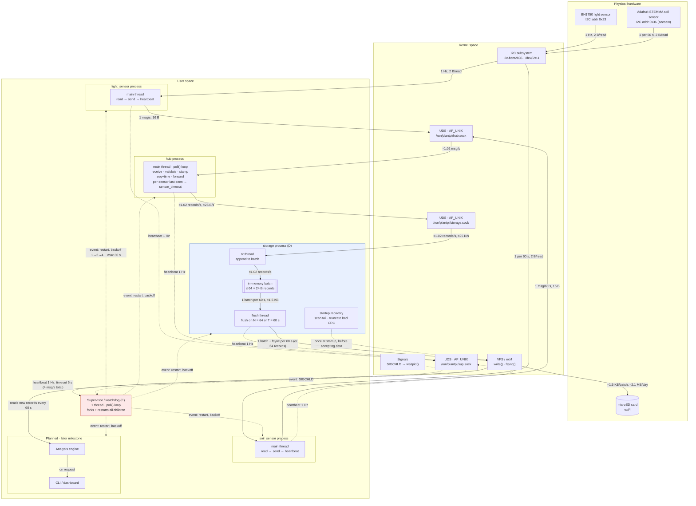

3-5 pages and the most leveraged hours of the whole project. Because every hour of arguing here saves five of rewriting later. Required contents:

## Green-Thumb Architecture Diagram

## Mechanism mapping

**Mechanism D — Custom Storage Layer**

**Choice:** an append-only log of fixed-size, checksummed records, kept in one segment file per day on the microSD (ext4). We chose it over a ring buffer or FUSE because only the log's tail can ever be damaged, which makes the crash-consistency story the simplest to state and test. **Guarantee:** *a record is committed once fsync returns; a power cut loses at most one unsynced batch (≤ 60 s) and never leaves a corrupt record readable.*

| Requirement (Green Thumb) | Mechanism | Implementing component | Justification | Measured by / target |
|---|---|---|---|---|
| Plant care needs an unbroken multi-day history | Append-only log; daily segments; 30-day retention | storage process, flush thread | Soil moisture changes over hours and watering trends over days, so the value is in the history. About 2.1 MB/day means 30 days is about 63 MB, which fits easily | 72 h soak: records committed = records sent by the hub (0 sequence gaps) |
| Keep write overhead and SD wear low | Batching: flush at N = 64 records or T = 60 s; single buffer copied out under the lock, no lock held during I/O | rx thread + flush thread | Fsyncing every record would mean about 88k fsyncs/day; batching cuts that to about 1,440/day. Soil changes slowly, so a 60 s commit delay costs nothing | Compare fsync count, write latency and CPU at (N,T) = (1, 1 s), (64, 10 s) and (64, 60 s) |
| A precise, provable durability point | fsync per batch; directory fsync when a new segment is created | flush thread | Without fsync, "written" only means the data reached the page cache. The directory fsync stops a new day's file from vanishing | Every commit logged with count and duration; report fsync p50/p99 |
| Survive being unplugged mid-write | 24 B records with CRC32; startup scan truncates at the first bad record before accepting data | storage startup recovery | A household Pi has no UPS and gets unplugged routinely. Fixed-size records make recovery a short arithmetic scan | 20 real power pulls mid-batch: 0 corrupt records accepted, loss ≤ 1 batch (60 s), recovery < 1 s |
| No loss on a normal shutdown or restart | Flush and fsync on SIGTERM | flush thread | Supervisor restarts and user shutdowns shouldn't cost a batch | 20 SIGTERM restarts: 0 records lost |
| Never fail silently | Check every write/fsync; keep the batch and retry; degraded after 3 consecutive failures | flush thread | A silent hole would undermine the history claim, which is D's selling point | Inject write/fsync errors: 100% logged as `storage_write_error`, 0 silent losses |
| Preserve history through a storage outage | 1 MB queue (about 11 h); `storage_backlog` at 50/75/90%; when full, an explicit degraded state that refuses and counts new readings, then writes a gap record on recovery | storage process | Better a marked gap than a silent one. Storage keeps reading its socket, so the hub and sensors never block and E's heartbeats are unaffected | Outage longer than the queue (with a small test cap): 0 accepted readings lost, and the gap record's count equals the refused count |
| Restarts must not corrupt the log (D meets E) | Recovery runs before `storage.sock` accepts data | storage startup recovery + supervisor | The supervisor can kill storage at any instant, so a kill is just a power cut without the reboot | 50 random `kill -9`s on storage: 0 corrupt records |

## Failure-mode table

Log format for every component: `timestamp level component event key=value`. Rule: whichever component refuses a reading records the gap (start, end, count), so no reading is ever lost silently.

| Component | Failure | Detection | Response | Log |
|---|---|---|---|---|
| Sensor (I2C) | Read fails (NACK, EIO, unplugged) | `read`/`ioctl` returns -1 | Retry 3× at 10 ms, then skip the sample; after 10 consecutive failures, mark offline and retry every 5 s | `i2c_read_error`, `sensor_offline`, `sensor_online` |
| Sensor → hub | Hub down or restarting; local ring overflows | `send`/`connect` returns EPIPE, ECONNREFUSED or ENOENT; ring full | Buffer up to 64 readings, reconnect with 100 ms → 2 s backoff, then resend; on overflow, refuse and count, then send a gap record on reconnect | `ipc_disconnect`, `ipc_reconnect`, `ipc_overflow` |
| Hub | Malformed, lost or out-of-order message | Length/magic/version check; gap in the sensor-side counter | Discard a malformed message and close the connection so the sensor resyncs; report counter gaps | `ipc_bad_message`, `sensor_seq_gap` |
| Hub | Sensor goes quiet | Last-seen timer: 3 s for light, 180 s for soil | Mark the sensor stale and keep running on the other sensor | `sensor_timeout`, `sensor_resumed` |
| Hub | Out-of-range reading | Range check (light 0–65535 lux; soil within the seesaw's raw range) | Reject and count; invalid data is not stored | `reading_invalid` |
| Hub | Process crashes or hangs | SIGCHLD, or no heartbeat for 5 s | Supervisor restarts it with backoff (SIGKILL first if hung); sensor rings cover the downtime | `child_exit` / `heartbeat_timeout`, `hub_start` |
| Hub → storage | Storage restarting, recovering or slow | `send` returns EPIPE, ECONNREFUSED or EAGAIN | Hold up to 1024 records (about 17 min), reconnect, and drain in order | `storage_unreachable`, `storage_reconnected` |
| Hub → storage | Hub queue full | Queue depth | Refuse and count new readings; send one gap record to storage before draining | `hub_queue_full` |
| Storage | `write()` or `fsync()` fails | Return value check | Keep the batch in memory and mark degraded; on the next cycle, truncate the log back to the last committed offset, then rewrite the batch and fsync, so no duplicate or partial records reach the log | `storage_write_error` / `fsync_error`, `storage_degraded` |
| Storage | Disk full, or backlog fills during an outage | ENOSPC / `statvfs`; queue depth (1 MB, about 11 h) | Log the backlog at 50/75/90%; never delete history early; when full, refuse and count new readings and write a gap record on recovery | `storage_disk_full`, `storage_backlog`, `storage_degraded`, `storage_recovered` |
| Storage | Corrupt tail or bad segment header after a crash | Startup scan: bad magic, CRC or header, backwards seq, partial record | Truncate at the first bad record (or rename a bad segment to `.corrupt`) and fsync, then accept data | `recovery_event`, `segment_corrupt` |
| Storage | Process crashes or hangs | SIGCHLD, or no heartbeat for 5 s | Supervisor restarts it; recovery runs before the socket accepts data | `child_exit` / `heartbeat_timeout`, `recovery_event` |
| Power | Power cut mid-write | No clean-shutdown marker at boot | Recovery scan before accepting data. A record is committed once fsync returns; a power cut loses at most one unsynced batch (≤ 60 s), plus any backlog held in memory during a storage outage, and never leaves a corrupt record readable | `unclean_shutdown`, `recovery_event` |
| System clock | Wrong time after a reboot (no real-time clock) | NTP sync status from `adjtimex` | Store readings anyway (seq keeps their order) and log the unsynced period | `clock_unsynced`, `clock_synced` |

**• Storage and data. What is stored, at what rate, in what format, with what retention, and what happens to it when the power dies mid-write.**
What exactly is stored?
[ ] Soil + light + timestamp?
[ ] What is the sampling rate?
[ ] What is the storage format?
[ ] How are records organized?
[ ] How long are they retained?
[ ] How are writes batched?
[ ] When is data flushed?
[ ] How do you recover from a mid-write failure?

**• Constraints and substitutions. What the ideal build would use, what you’re actually using, and what the gap costs: sensors downgraded, data synthesized or replayed, claims narrowed (Section 5). A design document with nothing to report here has usually not met its hardware yet.**
Briefly document:
- [ ] Raspberry Pi CPU/RAM limitations
- [ ] SD/storage limitations
- [ ] IPC overhead
- [ ] Budget limitations
- [ ] Power-loss considerations

**• Evaluation plan. The measurements you will take (Section 9), each with its method and its target. Numbers you commit to now are twice as credible when you hit them later. And instructive either way.**
Write down what you'll eventually measure:
- [ ] IPC latency
- [ ] Sensor-to-storage latency
- [ ] Storage write throughput
- [ ] CPU usage
- [ ] Memory usage
- [ ] Data loss/corruption
- [ ] Recovery time after failure
- [ ] Behavior under sustained sampling

**• Ownership map. Which partner owns which subsystems (Section 10.1). Ownership means first authorship and answerability at the defense, not exclusivity.**
Lily (Heron-i) owns the: sunlight sensor, IPC/data pipeline, Hub/aggregator, storage, mechanism D, recovery/supervision, and pipeline evaluation
