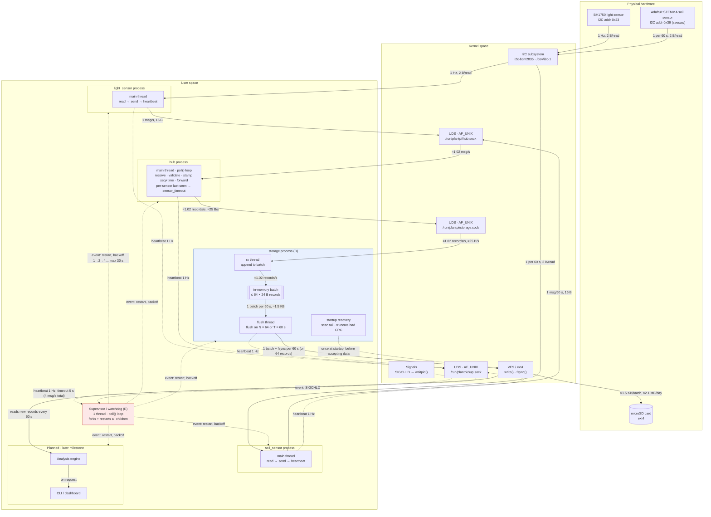

3-5 pages and the most leveraged hours of the whole project. Because every hour of arguing here saves five of rewriting later. Required contents:

## Green-Thumb Architecture Diagram

**• Mechanism mapping. For each chosen menu item: which component implements it, and a justification from the user’s requirements (“the vibration analysis is meaningless above 2 ms of sampling jitter, hence SCHED_FIFO”).**

### Mechanism D — Custom Storage Layer

| Requirement / Problem | Mechanism | Implementing Component | How It Works | How We Measure It |
|---|---|---|---|---|
| Sensor data needs to remain available for later plant-care analysis | Custom storage layer | Storage subsystem | Stores sensor readings in a persistent custom data format | Verify all generated samples are recoverable from storage |
| Green Thumb continuously produces sensor data | Custom storage layer | Storage subsystem | Collects sensor records and writes them to storage in controlled batches | Measure sustained write throughput and storage rate |
| Frequent individual writes could add unnecessary overhead | Custom storage layer | Storage subsystem | Batches multiple sensor records before committing them to storage | Compare write behavior/latency with different batch sizes |
| Sensor data should survive normal program termination | Custom storage layer | Storage subsystem | Explicitly flushes/commits buffered data to persistent storage | Restart system and verify previously stored records remain intact |
| Mid-write power failure could leave incomplete/corrupt data | Custom storage layer | Storage/recovery component | Detects incomplete records when storage is reopened and recovers or discards them | Inject interrupted writes and measure successful recovery/data loss |
| The system should detect storage failures rather than silently losing data | Custom storage layer | Storage subsystem | Checks write/flush errors and records failures in the system log | Inject storage/write failures and verify detection + logging |
1. Mechanism D — make the decision

My task:
- [ ] Decide exactly what your custom storage layer is.
- [ ] Decide what data structure/file format it uses.
- [ ] Decide how writes happen.
- [ ] Decide how batching works.
- [ ] Decide when fsync() happens.
- [ ] Decide what happens if power fails during a write.
- [ ] Write why this mechanism is useful for Green Thumb, not just how it works.

**• Failure-mode table. For each component: how it can fail, how the failure is detected, what the system does about it, and what the log will show. The soak test (Section 3.4) will grade this table’s honesty.**

| Component | Failure | Detection | Response | Log |
|---|---|---|---|---|
| Sensor → IPC | Message never arrives | Timeout | Log/drop/retry | `sensor_timeout` |
| IPC | Connection failure | Error/timeout | Reconnect/restart | `ipc_failure` |
| Hub | Process dies | Supervisor | Restart | `hub_restart` |
| Storage | Write fails | Return/error check | Log/retry/degrade | `storage_write_error` |
| Storage | Partial record | Record validation | Discard/recover | `corrupt_record` |
| Power | Mid-write failure | Record validation | Recover log | `recovery_event` |
| Supervisor | Child process dies | Process monitoring | Restart | `child_restart` |

**• Storage and data. What is stored, at what rate, in what format, with what retention, and what happens to it when the power dies mid-write.**
What exactly is stored?
[ ] Soil + light + timestamp?
[ ] What is the sampling rate?
[ ] What is the storage format?
[ ] How are records organized?
[ ] How long are they retained?
[ ] How are writes batched?
[ ] When is data flushed?
[ ] How do you recover from a mid-write failure?

**• Constraints and substitutions. What the ideal build would use, what you’re actually using, and what the gap costs: sensors downgraded, data synthesized or replayed, claims narrowed (Section 5). A design document with nothing to report here has usually not met its hardware yet.**
Briefly document:
- [ ] Raspberry Pi CPU/RAM limitations
- [ ] SD/storage limitations
- [ ] IPC overhead
- [ ] Budget limitations
- [ ] Power-loss considerations

**• Evaluation plan. The measurements you will take (Section 9), each with its method and its target. Numbers you commit to now are twice as credible when you hit them later. And instructive either way.**
Write down what you'll eventually measure:
- [ ] IPC latency
- [ ] Sensor-to-storage latency
- [ ] Storage write throughput
- [ ] CPU usage
- [ ] Memory usage
- [ ] Data loss/corruption
- [ ] Recovery time after failure
- [ ] Behavior under sustained sampling

**• Ownership map. Which partner owns which subsystems (Section 10.1). Ownership means first authorship and answerability at the defense, not exclusivity.**
Lily (Heron-i) owns the: sunlight sensor, IPC/data pipeline, Hub/aggregator, storage, mechanism D, recovery/supervision, and pipeline evaluation
