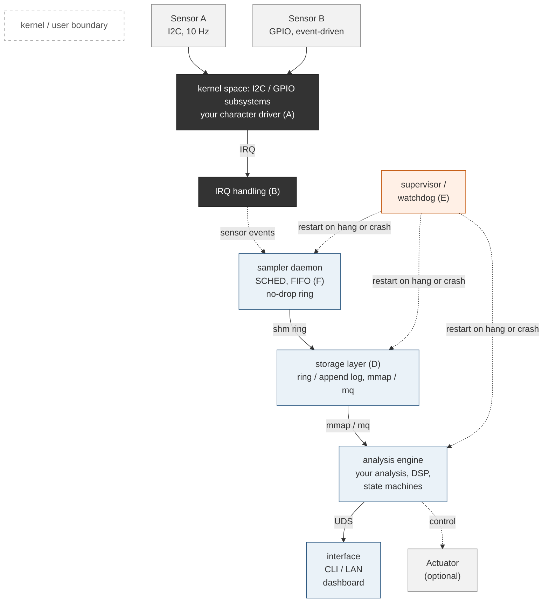

# CS370: Term Project
For Colorado State University's Operating Systems course, we were tasked with creating a term project that would address a real-world problem and present a solution that isn't easily solved with an application. This project suggests utilizing a low cost, single-board computer (Raspberry Pi) with a minimum of two sensors.

## Our Project: The Plant Owner's Capable Assistant (in-progress)
For our project, we are creating a mini houseplant assistant that enables a user to give their plants the best care possible by measuring soil-moisture and light exposure. We believe this project is not easily solved by an app, and that current similar products on the market, have shown common gaps in their capabilities. Thus, we want to create an effective solution that will help bridge the communication gap between plants and humans.

