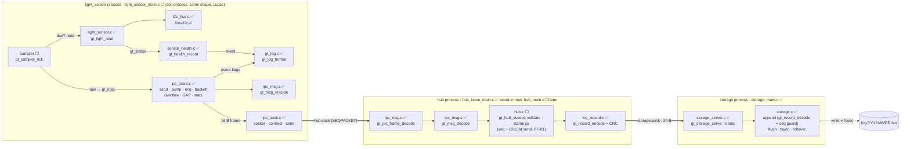

# Sensor Pipeline: plan and status

The official plan for Green Thumb's sensor-side pipeline, from the I2C seam up to the 16 B message a sensor process sends to the hub and the 24 B record the hub sends to storage. That covers the BH1750 light-sensor driver and the shared pieces it relies on: sensor health tracking, the log line formatter, the sensor→hub message and the hub→storage record codec, plus the IPC client that carries the 16 B message over `hub.sock`. A new session should be able to read this file, plus `CLAUDE.md` and `DESIGN.md`, and pick up where work stopped without re-explanation.

Since 2026-10-26 the file also holds a second top-level part, *Mechanism D: storage*, with its own Goal, Code map, Decisions, Status, *Not done yet* and Log. So there are two Status sections: **Status** (the sensor pipeline and IPC, Steps 0–24) and **Status (Mechanism D)** (storage). **Update either Status section only at the end of the day, when asked.**

## Context
- **Owner:** Lily (DESIGN.md → Ownership map: "Light sensor (driver and process)" and "IPC (data path)").
- **Goal of this phase:** prove the sensor is *electrically alive* and *trustworthy* before it is connected to the data pipeline. That means the bus opens, the chip ACKs, reads decode, failures are retried and bounded, and a sensor that keeps failing is marked offline instead of silently producing nothing. Then pin the wire message the light process will send.
- **Goal of the IPC phase (Steps 10–24):** a reading leaves the sensor process and reaches a hub stand-in (`hub_listen`) over `hub.sock`. It survives the hub being killed and restarted (buffered, then resent in order, or covered by a GAP), and the client never blocks the 1 Hz sampling.
- **Hardware:** BH1750 on `/dev/i2c-1` at address `0x23` (ADDR pin low or floating). Continuous high-res mode at 1 lx/count; each conversion takes at most 180 ms. Lux = raw / 1.2. **Raw counts are stored, never lux.**
- **Sampling rate:** 1 Hz (DESIGN.md). The 1 Hz schedule belongs to the sampler, not the driver.
- **Rule from DESIGN.md's failure-mode table (Sensor (I2C) row):** retry 3× at 10 ms, then skip the sample. After 10 consecutive failures, mark the sensor offline and retry every 5 s. Log `i2c_read_error`, `sensor_offline` and `sensor_online`.

## Design principle
- **Layered seam:** `src/i2c_bus.c` is the only file that makes I2C system calls. The driver talks to the bus only through `gt_i2c_ops` (`write` / `read` / `sleep_ms` / `close`). Tests swap in `tests/fake_i2c.h`, so every driver path, including injected NACKs and short reads, runs in WSL/CI with no hardware.
- **Logic stays separate from hardware** (CLAUDE.md): anything that can be pure logic (health tracking, message encoding) takes its inputs as arguments (`gt_status`, `now_ms`, bytes) and makes no system calls.
- **Each layer fails explicitly:** a failure returns a `gt_status` and leaves outputs untouched. No layer invents a value.
- **IPC seam (same idea as the I2C seam):** `src/ipc_sock.c` is the only file that makes socket system calls (`socket`, `connect`, `send`, `close`). The IPC client (`src/ipc_client.c`) talks to the socket only through `gt_sock_ops` (`connect` / `send` / `disconnect` / `destroy`), with the current time passed in as `now_ms`. Tests swap in `tests/fake_sock.h`, so the backoff, ring and GAP logic all run in WSL/CI with no hub and no real waiting.

### Code map
How the modules work together to carry a reading from sensor → IPC → hub → storage. Legend: ✅ done · ☐ later. The IPC phase (Steps 10–24) is complete; `hub_listen` stands in for the hub until `hub.c` exists. The storage process is built (*Mechanism D: storage* at the end of this file has its own, more detailed code map).



**Who calls whom (one row per arrow):**

| Caller | Callee | Passes | Returns |
|---|---|---|---|
| sensor main loop | `gt_sampler_tick` | `now_ms` | — |
| sampler | `gt_light_read` | — | `gt_status` + raw count |
| sensor main loop | `gt_health_record` | that status + `now_ms` | OFFLINE / ONLINE event |
| sensor main loop | `gt_ipc_client_send` / `_pump` | `gt_msg{DATA, LIGHT, counter, seq=0, raw}` + `now_ms` | `gt_status` + event flags |
| `ipc_client.c` | `gt_msg_encode` | `gt_msg` | 16 B frame (into the ring) |
| `ipc_client.c` | `gt_sock_ops` (`ipc_sock.c`, or the fake in tests) | the frame | OK / FULL (`EAGAIN`) / IO (peer gone) |
| sensor main loop | `gt_log_format` | the event name + `key=value` fields | the log line |
| hub `recv()` | `gt_ipc_frame_decode` | 17 B buffer + length | `gt_msg`, or CORRUPT / IO |
| hub | `gt_hub_accept` | `gt_msg` + `now_us` | `gt_record` with `seq` left 0 (PF-01) |
| hub sender | `gt_next_seq`, then `gt_record_encode` | the queued record, stamped with `next_seq` just before `send()` | 24 B → `storage.sock` |
| `storage_main` | `gt_storage_open` (wraps `gt_storage_open_ops` with the Linux file layer) | log directory + `now_us` | `gt_storage` + open info (recovery, last `seq` and its time) |
| storage rx loop (`gt_storage_serve`) | `gt_storage_append` | the raw 24 B as received + `now_ms` (decoded and checked inside, stored unchanged) | OK / CORRUPT / FULL + event flags |
| storage flush thread (`gt_flusher_tick`) | `gt_storage_rollover`, then `gt_storage_flush` | `now_us`, `now_ms`, clock synced | write + fsync of the pending batch, event flags |

### The "electrically alive" ladder
Each rung can only be checked once the rung below it passes. `light_probe` prints rungs 1–4 as a PASS/FAIL checklist on the Pi.

| Rung | What it proves | Where it's checked | Detected by |
|---|---|---|---|
| 1 | The I2C bus device opens (I2C enabled, permissions OK) | `light_probe` check 1; LSO-02 | `open()` fails → ENOENT / EACCES hint |
| 2 | A BH1750 ACKs at 0x23 (wiring, ADDR pin, power) | `light_probe` check 2; LSO-03/04 | First write (POWER_ON) is NACKed |
| 3 | One measurement reads and decodes | `light_probe` check 3; LSR-01..03 | 2-byte read, high byte first |
| 4 | Sampling holds 1 Hz with p99 jitter < 10 ms | `light_probe` check 4 | `CLOCK_MONOTONIC` deviation from an absolute schedule |
| 5 | A sensor that keeps failing is marked offline, probed every 5 s, and announced when it comes back | **Steps 1–3 (health tracker + log line)** | 10 consecutive failed reads |

### Open: what each failure point has acquired, and what must be unwound
`gt_light_open_bus` takes ownership of the bus, so the caller never cleans up:

| Fails at | Acquired so far | Unwound | Returns |
|---|---|---|---|
| `bus.ops == NULL` | nothing | nothing | `NULL` |
| `malloc` of driver state | the bus | `bus.ops->close` | `NULL` |
| POWER_ON / RESET / CONT_HRES write | bus + state | close the bus once, `free(s)`, no settle wait | `NULL` |
| after CONT_HRES | — | waits 180 ms so the first read returns real data | handle |

### Read: budget
In the worst case a read makes 1 try + 3 retries with 3 × 10 ms gaps, so it waits 30 ms, far inside the 1 s period. On failure the function returns `GT_ERR_IO` with `raw_out` untouched, so the caller skips the sample (LSR-07). The same handle works again after an outage, with no reopen (LSR-09).

## Decisions
- **The health tracker is generic** (`sensor_health`), not light-only, so the soil process can reuse it. It is a small public struct with no malloc.
- **Health input:** any non-`GT_OK` result from `gt_light_read` counts as one failure. The driver's 3 retries are already inside a single failed read.
- **Health output:** `gt_health_record` returns a transition event (`NONE` / `OFFLINE` / `ONLINE`) and the caller logs it. The tracker does no I/O.
- **Time is passed in** as `now_ms`, matching `gt_sampler_tick`, so tests need no clock.
- **Test ID prefixes:** `SHR` (sensor health record), `SHS` (sensor health should-read), `SHE` (sensor health event name), `LGF` (log format), `MSE` (message encode), `MSD` (message decode), `CRC` (CRC-32), `RCE` (record encode), `RCD` (record decode), `IFD` (IPC frame decode), `ICO` (IPC client open), `ICC` (IPC client close), `ICS` (IPC client send), `ICR` (IPC client reconnect), `IOV` (IPC client overflow), `IPL` (IPC loopback over a real socket).
- **Log ownership:** the light sensor's events (`i2c_read_error`, `sensor_offline`, `sensor_online`) are Lily's, as the light process's read-failure handling. The shared formatter (`gt_log_format`) has no owner in the Ownership map because every component uses it, so it counts as **Joint → Architecture integration**. Lily writes it first, as its first caller; give Lucas a heads-up so his components reuse it.
- **Log line:** `<timestamp_us> <LEVEL> <component> <event>[ key=value ...]`. The timestamp is µs since the Unix epoch, as a plain integer, the same unit as the on-disk record, so logs and records can be joined. The levels are `DEBUG` / `INFO` / `WARN` / `ERROR`. The light process logs `sensor_offline` as WARN and `sensor_online` as INFO.
- **Log sink deferred:** the formatter only fills a caller-provided buffer. Where lines go (stderr, a file or the monitor process) and reading the wall clock are decided with the light process. DESIGN.md doesn't specify either.
- **Hop 2 (hub→storage) carries the 24 B on-disk record** (decided 2026-10-23). The hub stamps `seq` and the µs timestamp, builds the record (CRC included), and storage checks it (amended 2026-10-26, PF-01: the timestamp is stamped on arrival, `seq` + CRC at send time; see *Hub contract (hop 2)*) with `gt_record_decode`, then appends it unchanged. There are two reasons. First, DESIGN.md already has the hub stamping the time and storage reading *records* from `storage.sock`. Second, a record that waits in the hub's 1024-record queue during a storage outage (up to about 17 min) keeps its real receive time. If storage stamped the time instead, the timestamp would be off by however long the record waited.
- **The hub's next `seq` after connecting to storage is max(own next, `seq_resume` + 1)** (decided 2026-10-26, PF-03). A freshly started hub has no counter, so it takes storage's reply + 1 (0 on an empty log). A running hub keeps its own counter, defined as 1 + the last `seq` whose `send()` succeeded, so records storage lost in a `kill -9` (unsynced, or still in the socket) leave a hole that storage turns into a GAP (`recovery_gap`). The alternative, always continuing from the reply, was rejected: it reuses the lost `seq`s, so the loss leaves no GAP and the hub's sent log holds duplicates, which breaks "no reading is lost silently" and the Evaluation plan's lost-readings formula. Only a loss where the hub restarts too (power cut) is shown by `unclean_shutdown` alone, which DESIGN.md's Power row already allows. Storage needed no change: its sequence guard already writes the GAP. This rule sets what PF-01 (when to stamp) and PF-02 (the sender's states) must support, and what `storage_faults.sh` checks (PF-04/05).
- **Hub contract for hop 2** (decided 2026-10-26, PF-01/PF-02): the hub stamps the time on arrival and `seq` + CRC at send; the socket seam gains `recv`; the sender waits for `seq_resume` (2 s deadline) before sending anything. See *Hub contract (hop 2)*.
- **Message magic is `0xA6`** (proposed), distinct from the on-disk record's `0xA7`, so a record can never be misread as a message.
- **Truncated messages are rejected at `recv()`,** which must return exactly `GT_MSG_SIZE`, not in decode. Decode keeps its fixed 16 B array.
- **Range checks stay in the hub:** decode doesn't check that light ≤ 65535. That is the hub's `reading_invalid` check.
- **Deferred:** `src/light_sensor_main.c` (open → sample → health → send) waited until the IPC client existed. The client was completed on 2026-10-24, so it is now the next item (see *Not done yet*).
- **`hub.sock` is AF_UNIX `SOCK_SEQPACKET`** (decided 2026-10-24). The kernel keeps message boundaries, so each `send()` is one whole 16 B message and each `recv()` returns exactly one message. A short message shows up as a short `recv()`, which is where DESIGN.md rejects it, and there are no partial sends to track. `SOCK_STREAM` would need frame reassembly and resync code in the hub.
- **`hub_listen` stands in for the hub on the Pi** (decided 2026-10-24) until `gt_hub_accept` and the hub process exist. It's a small tool (`src/hub_listen_main.c`, `make hub_listen`) that prints each decoded message and flags counter gaps. With it, the kill -9 / kill -STOP fault tests can run now.
- **The client never blocks the sampler:** every socket call is non-blocking, and `send` uses `MSG_NOSIGNAL`, so a dead hub returns `EPIPE` instead of raising SIGPIPE, which would kill the sensor process.
- **Time is passed in** (`now_ms` on `gt_ipc_client_send` / `_pump`), as with the health tracker, so the backoff tests need no clock and no sleeps.
- **Events are returned, not logged:** the client returns `GT_IPC_EV_DISCONNECT` / `_RECONNECT` / `_OVERFLOW` bit flags, and the caller logs `ipc_disconnect` / `ipc_reconnect` / `ipc_overflow`, the same pattern as `gt_health_record`.
- **`gt_ipc_client_open` doesn't connect.** A hub that isn't up yet is not an error (DESIGN.md, Mechanism E: processes tolerate unavailable peers at startup). The first attempt happens on the first send or pump.
- **GAP needs 2 free slots:** after an overflow, a new reading is accepted only when the ring can hold both the GAP and the reading. This keeps the order: old data, then the GAP, then new data. Otherwise the reading is refused and counted into the same gap.
- **Close drops the buffer:** `gt_ipc_client_close` sends nothing more. Readings still in the ring are lost, and that's documented, not silent.
- **Limitation (no app-level ack):** a message the kernel accepted but the hub never `recv()`d before dying is lost. The hub sees the jump in the counter as a `sensor_seq_gap`.
- **`gt_ipc_client_open_ops` is declared in `ipc_sock.h`, not `ipc.h`** (Step 11). `ipc_sock.h` includes `ipc.h`, so putting it in `ipc.h` would make the two headers include each other. `gt_light_open_bus` sits next to its seam in `light_sensor.h` for the same reason.
- **Ownership of the ctx:** once `ops` is non-NULL, the client owns the ctx and calls `destroy` exactly once, from `close` or straight away if the client can't be allocated. With NULL ops there's no `destroy` to call, so the caller keeps the ctx.
- **`send` drains, pushes, then drains again** (Step 18). Draining before the push sends older frames first, which can free the slot the new reading needs, so a reading isn't refused when the hub could already have taken the backlog.
- **Any send result other than OK or FULL counts as the hub gone** (Step 19): disconnect, report `GT_IPC_EV_DISCONNECT` and retry after the wait. Both failure paths (a failed connect and a lost hub) share `schedule_retry`, so the wait doubles the same way for each.
- **Order moved to fit the link** (decided 2026-10-24). Every test binary links every file in `src/`, so nothing in `src/` may call a function that doesn't exist yet. `gt_ipc_client_open` calls `gt_ipc_sock_linux`, so it moved from Step 16 to Step 22, and its tests ICO-03/04 moved from Step 15 to Step 21. ICC-03 needs `send` to leave a frame in the ring, so it moved from Step 17 to Step 18.
- **One listener per socket, enforced by a lock** (decided 2026-10-24). A process that listens on a socket (`hub_listen` now; the hub and storage later) first takes an `fcntl` write lock on `<socket>.lock` and holds it for its whole life. Only the lock holder may remove a leftover socket file and bind a new one; a second copy prints `already running` and exits without touching anything. The kernel drops the lock when the holder dies, `kill -9` included, so a crash never leaves a stale lock. This is safer than probing with `connect()`, which leaves a gap: two copies started together could both see the file as stale, and the second would take the first one's address. Closing *any* fd the process holds on the lock file releases the lock, so the file is opened in one place only. When the hub is written, this moves into a shared `src/` helper; testing it needs `fork()`, because a process never blocks on its own `fcntl` lock.

## Wire format: sensor → hub message (16 B, little-endian, encoded byte by byte)
| Off | Size | Field | Value |
|---|---|---|---|
| 0 | 1 | magic | `GT_MSG_MAGIC` = `0xA6` |
| 1 | 1 | version | `GT_MSG_VERSION` = 1 |
| 2 | 1 | type | `GT_MSG_DATA` = 1, `GT_MSG_GAP` = 2 (same values as `gt_rec_type`) |
| 3 | 1 | sensor_id | 1 light, 2 soil (0 = all is not valid on hop 1) |
| 4 | 4 | counter | sensor-side counter (for a GAP: the first refused counter) |
| 8 | 4 | seq | 0 from the sensor; the hub stamps it |
| 12 | 4 | value | DATA: raw count; GAP: refused-reading count |

Magic and version are written by encode and checked by decode. They are not `gt_msg` fields; `type` becomes one.

## Wire format: hub → storage record (24 B)
Hop 2 sends the on-disk record exactly as DESIGN.md *In what format → Record* lays it out: magic `0xA7`, type, version, sensor_id, seq (u32 at 4), timestamp (u64 µs at 8), value (u32 at 16) and CRC-32 over bytes 0–19 (at 20). `gt_record` and the codec live in `include/log_record.h`. **Watch the header order:** the record goes magic, **type, version**, sensor_id, while the message goes magic, **version, type**, sensor_id. Don't copy the message encoder without swapping those two bytes. Unlike the message, a GAP record may use sensor_id 0 (all).

## Hub contract (hop 2): stamping, numbering and the sender
Decided 2026-10-26 to settle PF-01 and PF-02 (Pipeline-Findings.md) before any hub code exists. It builds on the PF-03 numbering rule in *Decisions*. Nothing here is built yet. `include/hub.h` and `include/ipc_sock.h` change to match when the hub steps start, test first.

**Why it changes (PF-01):** a hub that has just started doesn't know its next `seq` until storage's `seq_resume` reply arrives. Storage may be down or still recovering, and Mechanism E says the hub must keep running anyway. So the hub can't finish a record (`seq` + CRC) when the sensor message arrives. It finishes it when it sends it.

### Who stamps what, and when
| Field | Set by | When | Why |
|---|---|---|---|
| `type`, `sensor_id`, `value` | `gt_hub_accept` | message arrives | copied from the checked message |
| `timestamp_us` | `gt_hub_accept` (`now_us` passed in) | message arrives | keeps the real receive time while the record waits in the queue (the 2026-10-23 reason still holds) |
| `seq` | the hop-2 sender | just before `send()` | only the sender knows the next `seq` (max rule) |
| CRC-32 | `gt_record_encode`, called by the sender | just before `send()` | the CRC covers `seq`, so it can't be computed earlier |

- **`gt_hub_accept`'s new contract:** validate, range-check and de-duplicate one `gt_msg`. On `GT_OK`, fill `*out` with type, sensor, value and `timestamp_us = now_us`, and leave `seq` at 0. The hub plan adds the event flags it returns (`reading_invalid`, `ipc_duplicate`, `sensor_seq_gap`). They're outside this contract.
- **The queue holds unstamped `gt_record`s:** 1024 slots of the in-memory struct (24 B with padding), so DESIGN.md's "1024 records × 24 B" budget still holds. A queued record has no `seq` and no CRC yet.
- **A `seq` is used only when `send()` returns `GT_OK`.** The sender stamps the queue head with `next_seq` and encodes it. On OK it drops the record and adds 1 to `next_seq`. On FULL or IO the record stays at the head, unchanged, and `next_seq` doesn't move, so a failed send never makes a hole in the numbering.

### The max rule, shared
- **`gt_next_seq`** (pure, in `include/storage_proto.h` next to `gt_resume`, because it says what the reply means): `gt_status gt_next_seq(int has_own, uint32_t own_next, const gt_resume *resume, uint32_t *next_out)`. It sets `*next_out` to max(`own_next`, `resume->seq` + 1). With `has_own` 0 (a fresh sender) it uses `resume->seq` + 1, or 0 when `resume->has_last` is 0. `GT_ERR_INVAL` for NULL arguments; `GT_ERR_FULL` when the reply's `seq` is `UINT32_MAX` (no next `seq` exists); `*next_out` is untouched on failure. Built and tested 2026-10-26 (NSQ 8/8).
- **Both callers use it:** the hop-2 sender and `storage_feed` (PF-04/05; `storage_feed` done 2026-10-26). The fault rounds then test the same numbering code the hub runs. `storage_proto.c` is Mechanism D's file, so give Lucas a heads-up.

### The socket seam gains `recv` (PF-02)
`gt_sock_ops` adds one op. The sensor client never calls it, but `src/ipc_sock.c` and `tests/fake_sock.h` both implement it:
```c
/* Receive one whole message into buf (cap bytes). Non-blocking.
 * GT_OK with *len_out = the message length, or *len_out = 0 when nothing
 * is waiting (EAGAIN); GT_ERR_IO when the peer closed (recv returns 0) or
 * reset the connection. */
gt_status (*recv)(void *ctx, uint8_t *buf, size_t cap, size_t *len_out);
```
- **The sender reads into `GT_RESUME_SIZE + 1` bytes**, like the storage and hub receivers, so an oversized reply shows up as too long.
- **`tests/fake_sock.h` grows:** scripted `recv` replies (bytes, "nothing yet", or IO), and its `sent` frames sized to 24 B as well as 16 B (they are fixed at `GT_MSG_SIZE` today).
- `gt_ipc_sock_linux(path)` already takes any path and sends any length, so it serves `storage.sock` unchanged apart from `recv`.

### Sender state machine (`include/hub_sender.h`, `src/hub_sender.c`)
```
              connect() OK → resume_deadline = now + 2000 ms
 DISCONNECTED ─────────────────────────────────────────────▶ AWAITING_RESUME
   ▲  attempt only when now ≥ next_attempt                        │ recv nothing yet → stay (until the deadline)
   │  backoff 100 ms → 2 s, as the client                         │ valid 8 B reply → gt_next_seq → SENDING
   │◀── deadline passes, or a bad / wrong-size reply ─────────────┤
   │    (ipc_bad_message), or recv IO: disconnect, retry later    │
   │                                                              ▼
   └──── send IO (EPIPE / ECONNRESET): head record kept ───── SENDING: drain oldest first,
         unstamped, storage_unreachable once                    stamp seq + encode + send;
                                                                FULL → stop, stay connected
```
- **Nothing is sent before the reply.** In AWAITING_RESUME, records only queue. This is the state the plan's two-state client lacks.
- **No call ever blocks:** the reply is polled with `recv` from `pump`, and a reply that never comes ends at the 2 s deadline (the same 2 s `storage_feed` waits). After that the sender disconnects and retries with backoff.
- **Own counter:** `has_own` becomes 1 after the first successful send in this process and stays 1 across reconnects. That's what lets storage see a `kill -9` loss as a hole (PF-03).
- **Storage sends nothing after the reply.** Anything received in SENDING is `ipc_bad_message`: disconnect and reconnect.
- **Events are returned as flags** (`storage_unreachable`, `storage_reconnected`, `hub_queue_full`), and the hub logs them, as `gt_ipc_client` does.
- **Queue full (`hub_queue_full`):** refuse and count, as the client ring does. The GAP needs 2 free slots, and the order is old records, then the GAP, then new ones. The GAP is `{type GAP, sensor_id 0, timestamp_us = the first refused reading's receive time, value = refused count}`, and it gets its `seq` at send like any other record.
- **API shape:** `gt_hub_sender_open_ops(ops, ctx)` (doesn't connect; owns the ctx as the client does), `gt_hub_sender_push(sender, const gt_record *unstamped, now_ms)` → OK / FULL / INVAL, `gt_hub_sender_pump(sender, now_ms)` → event flags, `gt_hub_sender_close`, and a stats getter (queued, refused, `next_seq`, `has_own`).

### Test prefixes (reserved; none collide with the existing ones)
`NSQ` next seq (fresh, running, empty log, reply ahead of the counter, NULL), `HAC` hub accept (fields, `seq` left 0, timestamp), `HSO` sender open/close, `HSR` resume wait (deadline, bad reply, IO, nothing sent before the reply), `HSS` sending (stamp on OK only, FULL keeps the head, IO keeps the head, the counter survives a reconnect), `HSQ` queue full and GAP, `HSL` loopback against `gt_storage_serve` over a real socket (a storage restart in the middle leaves a GAP for a running sender and none after a SIGTERM).

### Follow-ups this contract creates
- **DESIGN.md:** done 2026-10-26. The Hub → storage rows, the hub-queue budget and *At what rate* now say a record gets its `seq` + CRC when it is sent.
- **`include/hub.h`:** rewrite the `gt_hub_accept` comment to match (with the hub steps, not now).

## Health state machine
```
          10th consecutive failure → EV_OFFLINE, next_probe = now + 5000
 ONLINE ───────────────────────────────────────────────────▶ OFFLINE
   ▲  success → reset count                                     │ should_read() true only when now ≥ next_probe
   │  failure → count++ (no event before 10)                    │ failed probe → EV_NONE, next_probe = now + 5000
   └────────────────────── success → EV_ONLINE, count = 0 ◀─────┘
```

## IPC client: connection and ring rules
```
                 connect() OK → wait = 100 ms
                 (EV_RECONNECT only if a disconnect or failed attempt came before)
 DISCONNECTED ──────────────────────────────────────────────────────▶ CONNECTED
   ▲  attempt only when now ≥ next_attempt                              │ drain ring oldest first:
   │  connect() fails → next_attempt = now + wait,                      │   send OK   → drop frame, keep going
   │                     wait = min(wait × 2, 2000 ms)                  │   send FULL → stop (EAGAIN), stay connected
   └──── send IO (EPIPE / ECONNRESET) → EV_DISCONNECT once, frame kept, ◀┘
                                        next_attempt = now + wait
```
- **Starting state:** the client starts DISCONNECTED with `next_attempt = 0`, so the first send or pump tries to connect straight away. A clean first connect fires no event.
- **Backoff:** the waits run 100 → 200 → 400 → 800 → 1600 → 2000 ms, then stay at 2000 ms, so attempts fall at 0, 100, 300, 700, 1500, 3100, 5100 ms… Any successful connect resets the wait to 100 ms.
- **Ring:** 64 slots × 16 B (≈1 KB, DESIGN.md resource budget). Each message is encoded when it enters the ring, so a bad message is rejected (`GT_ERR_INVAL`) before it takes a slot. Frames leave only when `send` returns OK.
- **What `send` returns to the caller:**
  - `GT_OK`: the message was sent or buffered.
  - `GT_ERR_FULL`: it was refused and counted.
  - `GT_ERR_INVAL`: bad arguments or a bad message.

  A disconnect is not an error to the caller: it is reported through the event flags.
- **Overflow:**
  - **Ring full:** the new reading is refused, `refused` goes up by one, and the client remembers the first refused counter. `EV_OVERFLOW` fires once per overflow run, not once per refusal.
  - **Gap pending:** the next reading is accepted only when **2 slots** are free. The client then enqueues the GAP `{type = GAP, sensor_id, counter = first refused, value = refused count}`, followed by the reading. With fewer than 2 free slots, the reading is refused into the same gap.
  - **Order on the wire:** the buffered old data, then the GAP, then the new data.
- **`pump`:** does the same connect-and-drain as `send` without a new message. The sensor loop calls it every tick, so the ring still drains while the sensor is offline and not producing readings.
- **Close:** sends nothing and calls `destroy` once. Buffered frames are dropped.

## Steps
**Workflow** (CLAUDE.md and the user's preferences):
- One step per turn. Stop after each step for review; the user commits.
- Each write the user approves is at most a file skeleton plus one method, and ideally just one method (one test case counts as one method). A step is carried out as a series of these writes.
- Tests come first (red), then the implementation (green).
- A step is **done** only when `make test`, `make asan` and `make memcheck` all pass from WSL, with the output shown.
- Never weaken, skip or delete a test to make the suite pass.

### Step 0: foundation (done)
- **I2C seam:** `include/i2c_bus.h`, `src/i2c_bus.c` (Linux `open` + `ioctl(I2C_SLAVE)`, with EINTR handling).
- **Driver:** `include/light_sensor.h`, `src/light_sensor.c` (open/read/close, and the retry policy).
- **Test infrastructure:** `tests/check.h` (`CHECK`, `CHECK_EQ`, `RUN_TESTS`) and `tests/fake_i2c.h` (scripted reads, `fail_writes` / `fail_reads` / `fail_write_at`).
- **Tests (18):** `test_light_open.c` LSO-01..06, `test_light_read.c` LSR-01..10, `test_light_close.c` LSC-01..02.
- **On-Pi tool:** `src/light_probe_main.c` (`make light_probe`), which runs rungs 1–4.

### Step 1: health tracker header and tests (red)
- **New `include/sensor_health.h`:** `GT_HEALTH_OFFLINE_AFTER 10`, `GT_HEALTH_RETRY_MS 5000`, `gt_health_state`, `gt_health_event`, a `gt_health` struct (`state`, `consecutive_fails`, `next_probe_ms`), and three functions:
  - `void gt_health_init(gt_health *h);`
  - `int gt_health_should_read(const gt_health *h, uint64_t now_ms);`: online → 1; offline → 1 only once `now_ms ≥ next_probe_ms`; NULL → 0.
  - `gt_health_event gt_health_record(gt_health *h, gt_status st, uint64_t now_ms);`: NULL → `EV_NONE`.
- **New `tests/test_health_record.c`:**
  - SHR-01 init: online, 0 failures
  - SHR-02 9 consecutive failures stay online, no event
  - SHR-03 the 10th consecutive failure returns OFFLINE, exactly once
  - SHR-04 a success resets the run (9 fail, 1 ok, 9 fail → still online)
  - SHR-05 a failure while offline returns NONE (no repeated offline event)
  - SHR-06 a success while offline returns ONLINE and resets the count
  - SHR-07 a NULL tracker returns NONE without crashing
- **New `tests/test_health_should_read.c`:**
  - SHS-01 online → always true
  - SHS-02 offline at t → false at t+4999, true at t+5000
  - SHS-03 a failed probe while offline reschedules to probe_time + 5000
  - SHS-04 back online → true immediately
  - SHS-05 NULL → false
- **Expected red state:** the two new binaries fail to link. LSO/LSR/LSC still build and pass.

### Step 2: health tracker implementation (green)
- **New `src/sensor_health.c`:** about 40 lines, no system calls. The header comment cites the DESIGN.md failure-mode row. The Makefile's `LIB_SRC` wildcard picks it up automatically.
- **Done when:** all three targets pass, SHR 7/7 and SHS 5/5.

### Step 3: event-to-log path (3a red, 3b green)
This completes rung 5 end to end: the driver detects the failure, the tracker turns it into a transition, and the formatter turns that into a visible line. It depends on nothing from the IPC steps, and they depend on nothing here.
- **3a, new `include/gt_log.h`:** `gt_log_level` (`DEBUG`/`INFO`/`WARN`/`ERROR`), `GT_LOG_LINE_MAX 256`, and `gt_status gt_log_format(char *line_out, size_t line_size, uint64_t timestamp_us, gt_log_level level, const char *component, const char *event, const char *fields);`.
  - The output is always NUL-terminated.
  - `fields` is a caller-built `"key=value ..."` string, or NULL/"" for none.
  - It returns `GT_ERR_INVAL` for a NULL `line_out`/`component`/`event`, an unknown level, or a space inside `component`/`event`, and `GT_ERR_FULL` when the line doesn't fit.
- **3a, add to `include/sensor_health.h`:** `const char *gt_health_event_name(gt_health_event event);`, which returns `"sensor_offline"` or `"sensor_online"`, and NULL for NONE or an unknown value.
- **3a, new `tests/test_log_format.c`:**
  - LGF-01 a full line (`1700000000000000 WARN light_sensor sensor_offline fails=10`)
  - LGF-02 NULL or "" fields → no trailing space
  - LGF-03 each level prints its name
  - LGF-04 timestamps 0 and `UINT64_MAX` print in full
  - LGF-05 a buffer that is too small → `GT_ERR_FULL`, still NUL-terminated
  - LGF-06 NULL arguments → `GT_ERR_INVAL`
  - LGF-07 a space inside `component`/`event` → `GT_ERR_INVAL`
  - LGF-08 an unknown level → `GT_ERR_INVAL`
- **3a, add to `include/sensor_health.h`:** `#define GT_HEALTH_I2C_READ_ERROR "i2c_read_error"`. The process logs this name on every failed read. It is not a tracker event, so `gt_health_record` and the SHR/SHS tests are unchanged.
- **3a, new `tests/test_health_event_name.c`:** SHE-01 OFFLINE → `"sensor_offline"` · SHE-02 ONLINE → `"sensor_online"` · SHE-03 NONE → NULL · SHE-04 an out-of-range value → NULL · SHE-05 `GT_HEALTH_I2C_READ_ERROR` is `"i2c_read_error"`.
- **3a, expected red state:** the two new binaries fail only on undefined references. Everything else stays green.
- **3b, new `src/gt_log.c`:** one `snprintf` plus a level → name table, with no system calls. A result `>= line_size` means the line didn't fit.
- **3b, edit `src/sensor_health.c`:** add `gt_health_event_name`.
- **Done when:** all three targets pass, LGF 8/8 and SHE 5/5.

### Step 4: message layout and tests (red)
- **Edit `include/ipc.h`:** add `GT_MSG_MAGIC`, `GT_MSG_VERSION`, `GT_MSG_DATA` and `GT_MSG_GAP`, add a `uint8_t type` field to `gt_msg`, and add the layout comment from the table above. The `gt_msg_encode/decode` signatures stay as they are.
- **New `tests/test_msg_encode.c`:**
  - MSE-01 `GT_MSG_SIZE == 16`
  - MSE-02 header bytes 0–3 (magic, version, type, sensor_id)
  - MSE-03 the u32 fields are little-endian at offsets 4/8/12 (distinctive values such as `0x04030201`)
  - MSE-04 a GAP message encodes
  - MSE-05 an unknown type is rejected and `out` is untouched
  - MSE-06 sensor_id 0 or 3 is rejected
  - MSE-07 NULL args → `GT_ERR_INVAL`
- **New `tests/test_msg_decode.c`:**
  - MSD-01 round trip for DATA and GAP at the 0 and `UINT32_MAX` edges
  - MSD-02 decode of hand-built bytes (does not depend on encode)
  - MSD-03 bad magic → `GT_ERR_CORRUPT`, `m` untouched
  - MSD-04 bad version → `GT_ERR_CORRUPT`
  - MSD-05 unknown type → `GT_ERR_CORRUPT`
  - MSD-06 bad sensor_id → `GT_ERR_CORRUPT`
  - MSD-07 NULL args → `GT_ERR_INVAL`
- **Expected red state:** the two new binaries fail to link. Everything else stays green.

### Step 5: message implementation (green)
- **New `src/ipc_msg.c`:** `gt_msg_encode` / `gt_msg_decode` with byte-wise little-endian put/get helpers. The socket client goes in a separate `src/ipc_client.c` later. The `gt_ipc_client_*` declarations stay unimplemented, which is safe because nothing calls them yet.
- **Done when:** all three targets pass, MSE 7/7 and MSD 7/7.

### Step 6: docs
- **DESIGN.md:** add the 16 B sensor→hub layout table, and one line recording that the hop-2 format is still undecided, and why. Next to the log format (above the *Failure-mode table*), add one line recording the timestamp unit (µs since epoch, integer) and the level names.
- **Notes-with-Claude.md:** add one 2–4 sentence blurb each for the health tracker, the log line and the message layout.
- **This file:** update Status.

### Step 7: hop-2 docs and headers
- **DESIGN.md:**
  - *Storage and data → At what rate* ("On the wire"): hop 2 carries the 24 B record; the hub stamps `seq` and the time; storage checks it.
  - *In what format*, under the sensor → hub message table: "Open:" becomes "Decided:", with the reason.
  - *Constraints → Resource budget*: hub queue `1024 records × 24 B | ≈24 KB`.
  - *Constraints → IPC overhead*: "16 B messages sensor → hub and 24 B records hub → storage".
  - *Evaluation plan → IPC latency*: "a 16 B message (sensor → hub) and a 24 B record (hub → storage)".
  - *Ownership map → IPC (data path)*: adds "the 24 B record on `storage.sock`".
  - Consistency fixes found along the way: the Hub range check reads "light raw count 0–65535" (not lux), the stray assignment-prompt line at the top is removed, and the duplicated AI-usage heading is merged.
- **`include/ipc.h:23`:** replace the "still undecided" comment with "Hub → storage sends the 24 B record (log_record.h)."
- **`include/hub.h:11`:** `gt_hub_accept(..., gt_record *out)`, include `log_record.h`, and update the comment. Nothing calls it yet, so the build stays green.
- **`include/log_record.h`:** add a layout comment like the one in `ipc.h` (offsets 0–23, CRC over bytes 0–19, written byte by byte), plus short comments on each function.
- **Notes-with-Claude.md:** one 2–4 sentence blurb on why hop 2 sends the record.
- **Done when:** all three targets pass, with 57 tests unchanged.

### Step 8: record codec tests (red)
- **New `tests/test_crc32.c`:**
  - CRC-01 `"123456789"` → `0xCBF43926` (the standard CRC-32 check value)
  - CRC-02 a zero-length input → `0x00000000`
  - CRC-03 changing one bit changes the CRC
- **New `tests/test_record_encode.c`:**
  - RCE-01 `GT_REC_SIZE == 24`
  - RCE-02 header bytes 0–3 are magic, **type, version**, sensor_id
  - RCE-03 seq at 4, timestamp at 8 (u64), value at 16, all little-endian (distinctive values)
  - RCE-04 bytes 20–23 equal `gt_crc32(out, 20)`, little-endian
  - RCE-05 a GAP record with sensor_id 0 (all) encodes
  - RCE-06 an unknown type is rejected and `out` is untouched
  - RCE-07 DATA with sensor_id 0, or any sensor_id 3, is rejected
  - RCE-08 NULL args → `GT_ERR_INVAL`
- **New `tests/test_record_decode.c`:**
  - RCD-01 round trip for DATA and GAP at the 0 and max edges (timestamp `UINT64_MAX`)
  - RCD-02 decode of hand-built bytes, including a hand-computed CRC
  - RCD-03 bad magic (`0xA6`, a message) → `GT_ERR_CORRUPT`, `rec` untouched
  - RCD-04 bad version → `GT_ERR_CORRUPT`
  - RCD-05 unknown type → `GT_ERR_CORRUPT`
  - RCD-06 bad sensor_id → `GT_ERR_CORRUPT`
  - RCD-07 a CRC mismatch (one payload byte flipped) → `GT_ERR_CORRUPT`
  - RCD-08 NULL args → `GT_ERR_INVAL`
- **Expected red state:** the three new binaries fail only on undefined references. Everything else stays green.

### Step 9: record codec implementation (green)
- **New `src/log_record.c`:** a bitwise reflected CRC-32 (polynomial `0xEDB88320`, init and final XOR `0xFFFFFFFF`, no lookup table), plus encode and decode using byte-wise little-endian put/get helpers, as in `src/ipc_msg.c`. Decode checks the CRC before trusting any field. No system calls.
- **Done when:** all three targets pass, CRC 3/3, RCE 8/8 and RCD 8/8.

### Step 10: socket seam header
- **New `include/ipc_sock.h`:** `gt_sock_ops` with these four ops:
  - `connect(ctx)` → `GT_OK` / `GT_ERR_IO`
  - `send(ctx, buf, len)` → `GT_OK`, `GT_ERR_FULL` (`EAGAIN`: the kernel buffer is full but the peer is alive) or `GT_ERR_IO` (`EPIPE` / `ECONNRESET`: the peer is gone)
  - `disconnect(ctx)`: closes the fd and keeps the ctx
  - `destroy(ctx)`: frees the ctx

  It also declares `gt_status gt_ipc_sock_linux(const char *path, const gt_sock_ops **ops_out, void **ctx_out);`.
- **Done when:** the build is still green (nothing uses it yet).

### Step 11: `ipc.h` API
- **11a:** declare `gt_status gt_ipc_frame_decode(const uint8_t *buf, long len, gt_msg *out);`.
  - `len` ≤ 0 → `GT_ERR_IO` (the peer closed)
  - `len` ≠ 16 → `GT_ERR_CORRUPT`
  - otherwise it calls `gt_msg_decode`
  - The hub `recv()`s into a 17 B buffer, so an oversized packet is caught instead of being silently truncated.
- **11b:** the client API, with comments explaining `unsigned` bit flags:
  - `GT_IPC_RING_SLOTS` (64), `GT_IPC_BACKOFF_MIN_MS` (100) and `GT_IPC_BACKOFF_MAX_MS` (2000)
  - `GT_IPC_EV_DISCONNECT` / `_RECONNECT` / `_OVERFLOW`
  - a `gt_ipc_stats` struct (queued, sent, refused, reconnects)
  - `gt_ipc_client_send(client, message, now_ms, &events)`
  - `gt_ipc_client_pump(client, now_ms, &events)`
  - `gt_ipc_client_stats(client, &stats)`
  - `gt_ipc_client_open_ops(ops, ctx)`, which goes in `include/ipc_sock.h` (see *Decisions*)

  `gt_ipc_client_open(path)` and `_close` keep their names. The one-letter parameters `c` and `m` became `client` and `message` (CLAUDE.md naming rule).
- **Done when:** the build is still green (nothing calls these functions yet).

### Step 12: fake socket
- **New `tests/fake_sock.h`:** header-only, like `fake_i2c.h`.
  - Scripted `fail_connects`.
  - A per-call queue of send results.
  - A record of every frame sent.
  - Counters for connect, disconnect and destroy calls.
  - Counters for client bugs the fake can see: `connect_while_connected`, `send_while_disconnected` and `wrong_len_sends`. A correct client leaves all three at 0.
  - A `GT_ERR_IO` send result doesn't disconnect the fake by itself, so a client that forgets to call `disconnect()` shows up as `send_while_disconnected`.
  - `fake_sock_ops()` resets the fake and returns the ops table.
- **Done when:** the build is still green.

### Step 13: frame decode tests (red)
- **New `tests/test_ipc_frame.c`:**
  - IFD-01 exactly 16 B, valid → `GT_OK`, decoded
  - IFD-02 15 B → `GT_ERR_CORRUPT`, `out` untouched
  - IFD-03 17 B → `GT_ERR_CORRUPT`
  - IFD-04 len 0 or −1 → `GT_ERR_IO`
  - IFD-05 16 B with bad magic → `GT_ERR_CORRUPT`
  - IFD-06 NULL args → `GT_ERR_INVAL`
- **Expected red state:** the new binary fails only on an undefined reference.

### Step 14: frame decode implementation (green)
- **Edit `src/ipc_msg.c`:** add `gt_ipc_frame_decode`. No system calls.
- **Done when:** all three targets pass, IFD 6/6.

### Step 15: client open tests (red)
- **New `tests/test_ipc_open.c`:**
  - ICO-01 `open_ops` returns a handle and makes no connect, send or destroy call
  - ICO-02 NULL ops → NULL, and the ctx is never touched
- **Moved to Step 21:** ICO-03/04 open by path, which goes through `gt_ipc_sock_linux` (Step 22). They stay in this file.
- **Expected red state:** undefined references to `gt_ipc_client_open_ops` and `gt_ipc_client_close` only.

### Step 16: client skeleton (green)
- **New `src/ipc_client.c`:**
  - the file header
  - the client struct: a fixed `uint8_t ring[64][16]` circular queue (`head` + `count`), connection and backoff state (`connected`, `had_trouble`, `next_attempt_ms`, `backoff_ms`), the GAP being built, and `gt_ipc_stats`. No malloc beyond the struct, no VLA.
  - `gt_ipc_client_open_ops`, which uses `calloc` so everything starts at 0
  - `gt_ipc_client_close`
- **Moved to Step 22:** `gt_ipc_client_open`. It calls `gt_ipc_sock_linux`, and every test binary links all of `src/`, so writing it now would break every binary's link.
- **Done when:** all three targets pass, ICO 2/2.

### Step 17: client close tests
- **New `tests/test_ipc_close.c`:**
  - ICC-01 `destroy` is called exactly once
  - ICC-02 `close(NULL)` is safe
- **Moved to Step 18:** ICC-03, because only `send` can put a frame in the ring.
- **Expected state:** green straight away, since close already exists. This step checks it.

### Step 18: send, connected path (red → green)
- **New `tests/test_ipc_send.c`:**
  - ICS-01 the first send connects, then sends bytes equal to `gt_msg_encode`
  - ICS-02 several sends arrive in order
  - ICS-03 a bad type or sensor 0 → `GT_ERR_INVAL`, nothing queued or sent
  - ICS-04 NULL client or msg → `GT_ERR_INVAL`
  - ICS-05 `EAGAIN` keeps the frame, stays connected, no event
  - ICS-06 the next send flushes the held frame, then the new one
- **Add to `tests/test_ipc_close.c`:** ICC-03, closing with a frame buffered (left by one `EAGAIN`) sends nothing, Valgrind clean.
- **Edit `src/ipc_client.c`:**
  - the static `ring_push`
  - the static `drain`, connected path only
  - `gt_ipc_client_send`, which drains, pushes, then drains again

  Two temporary pieces stood in until Step 19: a single connect attempt with no backoff, and `(void)now_ms;` to keep `-Werror` quiet about the unused parameter.
- **Done when:** all three targets pass, ICS 6/6 and ICC 3/3.

### Step 19: reconnect and backoff (red → green)
- **New `tests/test_ipc_reconnect.c`:**
  - ICR-01 a failed connect → buffered, `GT_OK`, no event
  - ICR-02 attempts at 0/100/300/700/1500/3100 ms, never early
  - ICR-03 the wait caps at 2000 ms
  - ICR-04 a successful connect resets the wait to 100 ms
  - ICR-05 a gone peer → DISCONNECT once, frame kept, retry at +100 ms
  - ICR-06 reconnect → RECONNECT, ring drains oldest first
  - ICR-07 the first clean connect → no RECONNECT
  - ICR-08 `pump` reconnects and drains with no new message
- **Edit `src/ipc_client.c`:**
  - the static `schedule_retry`: the next attempt is now + the wait, the wait doubles up to 2000 ms, and the trouble is marked
  - the static `try_connect`: no attempt before the retry is due; on success the wait resets to 100 ms, and `RECONNECT` is reported only after trouble
  - `drain` uses `try_connect`; a send result of `GT_ERR_IO` disconnects, reports `DISCONNECT` and schedules a retry
  - `gt_ipc_client_send` collects events in a local and writes them out once (this removed the Step 18 temporaries)
  - `gt_ipc_client_pump`
- **Done when:** all three targets pass, ICR 8/8.

### Step 20: overflow and GAP (red → green)
- **New `tests/test_ipc_overflow.c`:**
  - IOV-01 64 readings buffered OK, the 65th → `GT_ERR_FULL` + OVERFLOW
  - IOV-02 OVERFLOW fires once per run, and `refused` counts every reading
  - IOV-03 the drain order is 64 data, then the GAP (first counter, count), then the new reading
  - IOV-04 with only 1 free slot, the new reading is refused into the same gap
  - IOV-05 a second overflow gives a second, separate GAP
- **Edit `src/ipc_client.c`:**
  - the static `enqueue_reading`: the overflow/refuse path. `send` calls it in place of `ring_push`.
  - the static `push_gap`, called from `enqueue_reading` once a pending gap has 2 free slots
  - `gt_ipc_client_stats`

  Each new static was wired in by the same write that added it, because `-Werror` makes an unused static a build error for every binary.
- **Done when:** all three targets pass, IOV 5/5.

### Step 21: loopback tests over a real socket (red)
- **New `tests/test_ipc_loopback.c`:** a real `SOCK_SEQPACKET` socket in a `mkdtemp` directory under `/tmp` (Windows-mounted drives in WSL2 don't reliably support socket files). `now_ms` is passed in, so the tests never sleep. Nothing blocks either: the listener is `SOCK_NONBLOCK` and every `recv` uses `MSG_DONTWAIT`, so a missing message is a FAIL line, not a hang. A small fixture comes in with IPL-01: the `loopback` struct plus `loopback_init`, `make_listener`, `recv_frame` and `loopback_cleanup`.
  - IPL-01 the listener receives 16 B, which frame-decodes to the same message
  - IPL-02 no listener (`ENOENT`) → buffered; once the listener appears → drained in order, with RECONNECT
  - IPL-03 the hub's connection and listener both close → DISCONNECT, no SIGPIPE crash (SIGPIPE is deliberately left at its default), frame kept; the retry finds no listener and stays quiet
  - IPL-04 light and soil clients share one listener, each stream in counter order
  - IPL-05 a raw 15 B packet arrives as 15 B and is rejected, `out` untouched; a 16 B packet sent after it arrives as exactly 16 (proves SEQPACKET keeps message boundaries)
- **Add to `tests/test_ipc_open.c`** (moved from Step 15):
  - ICO-03 `open(path)` with NULL, `""` or a 108 B path (the `sun_path` limit) → NULL
  - ICO-04 `open(path)` on a socket that doesn't exist still returns a handle, and its first `pump` is quiet (`GT_OK`, no event)
- **Expected red state:** undefined references to `gt_ipc_client_open` only. The tests never call `gt_ipc_sock_linux` directly; it arrives with `gt_ipc_client_open` in Step 22.

### Step 22: Linux socket implementation (green)
- **New `src/ipc_sock.c`:** the only file with socket system calls.
  - `sock_connect`: `socket(AF_UNIX, SOCK_SEQPACKET | SOCK_NONBLOCK | SOCK_CLOEXEC)` + `connect`
  - `sock_send`: `send(..., MSG_NOSIGNAL)`, mapping errno to a `gt_status`
  - `sock_disconnect` / `sock_destroy`
  - `gt_ipc_sock_linux`
- **Add to `src/ipc_client.c`** (moved from Step 16): `gt_ipc_client_open`, which is `gt_ipc_sock_linux` + `gt_ipc_client_open_ops`.
- **Done when:** all three targets pass, IPL 5/5 and ICO 4/4.

### Step 23: `hub_listen` on-Pi tool
- **New `src/hub_listen_main.c`:** `bind_listener`, `serve_one`, then `main`, plus `take_instance_lock` (see *Decisions*: one listener per socket).
  - **`main`:** one `poll()` loop serves the listener and up to 8 sensor connections at once, so light and soil can feed it together (ladder rung 5).
  - **`serve_one`:** handles one message from a ready connection. It prints `light 42 1234` for DATA and `light GAP first=65 count=26` for a GAP. Counters are checked per sensor, and a GAP counts as covering its range, so only an uncovered hole prints `sensor_seq_gap`. A bad packet prints `ipc_bad_message` and closes that connection (DESIGN.md Hub row).
  - **`bind_listener`:** removes a socket file left behind by a `kill -9`, but only if it is a socket (`lstat` + `S_ISSOCK`) and only while holding the instance lock.
- **Edit `Makefile`:** a `hub_listen` target modelled on `light_probe`. The `*_main.c` naming keeps it out of the test link.
- **Done when:** all three targets pass, and `make hub_listen` builds.

### Step 24: docs
- **DESIGN.md:** one line in *Constraints → IPC overhead* naming `SOCK_SEQPACKET`.
- **This file:** update Status at the end of the day, when asked.

### Later (not scheduled)
- **Hardware check:** run `make light_probe` on the Pi and record the rung 1–4 results and jitter numbers under Status.
- **Hub implementation:** `gt_hub_accept` validates a message, stamps the receive time, and builds the unstamped `gt_record` it queues (`seq` + CRC are added at send; see *Hub contract (hop 2)*). The hub process then replaces `hub_listen`, and the on-Pi rungs of the IPC ladder (see *Verification*) are run again against it.
- **Hop 2 sender (hub → `storage.sock`):** uses the `ipc_sock` seam with a new `recv` op to read `seq_resume`, and sends 24 B records from its own 1024-record queue (DESIGN.md: hub queue, about 17 min). It is not the 16 B `gt_ipc_client`, whose ring holds messages. Its states and API are in *Hub contract (hop 2)*.
- **`src/light_sensor_main.c`:** sampler at 1000 ms + health tracker + IPC client, plus a heartbeat to `sup.sock`. Also the log sink (stderr, a file or the monitor process) and wall-clock timestamps for log lines.

## Files
- **Done (Step 0):** `include/i2c_bus.h`, `src/i2c_bus.c`, `include/light_sensor.h`, `src/light_sensor.c`, `src/light_probe_main.c`, `tests/check.h`, `tests/fake_i2c.h`, `tests/test_light_{open,read,close}.c`
- **New (Steps 1–5):** `include/sensor_health.h`, `src/sensor_health.c`, `include/gt_log.h`, `src/gt_log.c`, `src/ipc_msg.c`, `tests/test_health_record.c`, `tests/test_health_should_read.c`, `tests/test_health_event_name.c`, `tests/test_log_format.c`, `tests/test_msg_encode.c`, `tests/test_msg_decode.c`
- **Modified:** `include/sensor_health.h` and `src/sensor_health.c` (Step 3), `include/ipc.h` (Step 4), `DESIGN.md` and `Notes-with-Claude.md` (Step 6)
- **Steps 7–9:** modified `DESIGN.md`, `include/ipc.h`, `include/hub.h`, `include/log_record.h` and `Notes-with-Claude.md` (Step 7); new `tests/test_crc32.c`, `tests/test_record_encode.c` and `tests/test_record_decode.c` (Step 8); new `src/log_record.c` (Step 9)
- **Steps 10–24:**
  - **New headers:** `include/ipc_sock.h` (Step 10), `tests/fake_sock.h` (Step 12).
  - **New tests:** `tests/test_ipc_{frame,open,close,send,reconnect,overflow,loopback}.c` (Steps 13–21).
  - **New sources:** `src/ipc_client.c` (Steps 16–20, plus `gt_ipc_client_open` in Step 22), `src/ipc_sock.c` (Step 22), `src/hub_listen_main.c` (Step 23).
  - **Modified:** `include/ipc.h` (Step 11), `include/ipc_sock.h` (Step 11, `gt_ipc_client_open_ops`), `src/ipc_msg.c` (Step 14), `tests/test_ipc_close.c` (Step 18, ICC-03), `tests/test_ipc_open.c` (Step 21, ICO-03/04), `Makefile` (Step 23, the `hub_listen` target only), `DESIGN.md` (Step 24).
  - **All done (2026-10-24):** every file above. The `hub_listen` instance lock also added a Decision to this file (Step 23).
- **Untouched:** the driver and the I2C seam. Through Step 9, the `Makefile` was untouched too, since its wildcards cover new files.

## Verification
```
wsl -e bash -lc 'cd /mnt/c/Users/lheer/OneDrive/Desktop/cs370/CS370_TermProject/The-Green-Thumb && make test && make asan && make memcheck'
```
- **After Steps 1, 3a, 4 and 8 (red):** only the new binaries fail, and only because they don't link.
- **After Step 7 (docs and headers):** the 57 existing tests still pass, unchanged.
- **After Steps 2, 3b, 5 and 9 (green):** every binary prints `N/N tests passed`, `-Wall -Wextra -Werror` stays clean, and Valgrind reports 0 errors and 0 bytes in use.
- If anything else fails, stop and report. Fix `src/`, never the tests.
- **After Steps 13, 15 and 21 (red), and the test half of Steps 18–20:** only the new binary (or binaries) fails, and only on undefined references. The existing binaries are built and run separately to confirm they stay green. Steps 18–20 go green once their methods land.
- **After Steps 10–12, 14, 16, 17 and 22 (green), and Steps 18–20 once complete:** every binary prints `N/N tests passed`, `-Wall -Wextra -Werror` stays clean, and Valgrind reports 0 errors and 0 bytes in use.
- **A header that nothing includes yet** (Step 10): compile it on its own with `-fsyntax-only` and the project flags, because `make test` won't compile it.
- **Before any test uses `tests/fake_sock.h`** (Step 12): a throwaway smoke program in the scratchpad exercised every op and counter.

### Light (+ Soil) → IPC → Hub ladder
Like the "electrically alive" ladder: each rung can only be checked once the rung below it passes.

| Rung | What it proves | Where it's checked | Pass when |
|---|---|---|---|
| 1 | The client's logic: backoff timing, ordering, GAP accounting, events fire once | IFD/ICO/ICC/ICS/ICR/IOV against `fake_sock.h` (WSL/CI) | all pass under `make test` / `asan` / `memcheck` |
| 2 | Real kernel behaviour: `ENOENT` / `ECONNREFUSED` before the hub is up, `EPIPE` without SIGPIPE, SEQPACKET message boundaries, two sensors on one socket | IPL (WSL/CI) | IPL 5/5 |
| 3 | A live light reading reaches a hub | Pi: `hub_listen /run/plantpi/hub.sock` + the light process (`light_sensor_main.c`, the next item after Step 24), for 10 min | messages = elapsed seconds ±1, no counter gaps, and covering the sensor drops the raw count |
| 4 | The client survives hub failures | Pi: `kill -9 hub_listen` for 10 s, then for 90 s; `kill -STOP` for 60 s | 10 s: one `ipc_disconnect` + `ipc_reconnect`, about 10 buffered readings arrive in order, no gap. 90 s: `ipc_overflow`, then a GAP with `value` ≈ 26 (90 − 64), and the data counters + `gap.value` cover every counter. STOP: sends get `EAGAIN` while sampling holds 1 Hz with p99 jitter < 10 ms (the client never blocks) |
| 5 | The soil sensor joins | Pi: Lucas's soil process uses the same client (`sensor_id = SOIL`), and both processes feed one `hub_listen` | both streams arrive interleaved, each with its own contiguous counters |
| 6 | The real hub | Pi: the hub process (`gt_hub_accept`) replaces `hub_listen` | rungs 3–5 pass again, and `storage.sock` receives valid 24 B records |

## Status
_Update at the end of the day, when asked: tick the step table, and add one Log entry with the date, what landed, test counts, and anything surprising._

| Step | What | State |
|---|---|---|
| 0 | Seam, driver, 18 tests, light_probe | ✅ Done (branch `adapt_test_structure`, through `a74ca65`) |
| 1 | Health header + SHR/SHS tests (red) | ✅ Done, red confirmed (2026-10-23) |
| 2 | `src/sensor_health.c` (green) | ✅ Done (2026-10-23): SHR 7/7, SHS 5/5 |
| 3 | Log formatter + event names (3a red, 3b green) | ✅ Done (2026-10-23): LGF 8/8, SHE 5/5 |
| 4 | `ipc.h` layout + MSE/MSD tests (red) | ✅ Done, red confirmed (2026-10-23) |
| 5 | `src/ipc_msg.c` (green) | ✅ Done (2026-10-23): MSE 7/7, MSD 7/7 |
| 6 | DESIGN.md, notes, this file | ✅ Done (2026-10-23) |
| 7 | Hop-2 docs and headers (`ipc.h`, `hub.h`, `log_record.h`) | ✅ Done (2026-10-23): 57 tests unchanged |
| 8 | CRC/RCE/RCD tests (red) | ✅ Done, red confirmed (2026-10-23): failed only on undefined references |
| 9 | `src/log_record.c` (green) | ✅ Done (2026-10-23): CRC 3/3, RCE 8/8, RCD 8/8; 76 tests across 12 binaries, 0 Valgrind errors |
| 10 | `include/ipc_sock.h` (socket seam) | ✅ Done (2026-10-24): checked on its own with `-fsyntax-only` |
| 11 | `ipc.h` client API + `gt_ipc_frame_decode` | ✅ Done (2026-10-24): 76 tests unchanged |
| 12 | `tests/fake_sock.h` | ✅ Done (2026-10-24): scratchpad smoke test passed |
| 13 | IFD tests (red) | ✅ Done, red confirmed (2026-10-24) |
| 14 | `gt_ipc_frame_decode` (green) | ✅ Done (2026-10-24): IFD 6/6 |
| 15 | ICO-01/02 (red) | ✅ Done, red confirmed (2026-10-24); ICO-03/04 moved to Step 21 |
| 16 | `src/ipc_client.c` skeleton: `open_ops`, `close` (green) | ✅ Done (2026-10-24): ICO 2/2; `gt_ipc_client_open` moved to Step 22 |
| 17 | ICC-01/02 | ✅ Done (2026-10-24): ICC 2/2; ICC-03 moved to Step 18 |
| 18 | Send, connected path + ICC-03 | ✅ Done (2026-10-24): ICS 6/6, ICC 3/3 |
| 19 | Reconnect and backoff, `pump` | ✅ Done (2026-10-24): ICR 8/8; 101 tests across 17 binaries, 0 Valgrind errors |
| 20 | Overflow, GAP, `stats` | ✅ Done (2026-10-24): IOV 5/5 |
| 21 | IPL loopback tests + ICO-03/04 (red) | ✅ Done, red confirmed (2026-10-24): failed only on undefined `gt_ipc_client_open` |
| 22 | `src/ipc_sock.c` + `gt_ipc_client_open` (green) | ✅ Done (2026-10-24): IPL 5/5, ICO 4/4; 113 tests across 19 binaries, 0 Valgrind errors |
| 23 | `hub_listen` on-Pi tool + instance lock | ✅ Done (2026-10-24): `make hub_listen` builds; smoke-tested in WSL against the real client |
| 24 | Docs (DESIGN.md, this file) | ✅ Done (2026-10-24) |
| — | IPC ladder rungs 1–2 (WSL/CI) | ✅ Pass (2026-10-24): rung 1 IFD/ICO/ICC/ICS/ICR/IOV, rung 2 IPL 5/5 |
| — | IPC ladder rungs 3–6 (on the Pi) | ☐ Needs `src/light_sensor_main.c` (rungs 3–4), the soil process (rung 5) and the hub (rung 6) |
| — | On-Pi `light_probe` run | ☐ Not recorded |
| — | Hop-2 (hub→storage) format | ✅ Decided 2026-10-23: the 24 B record (see Decisions) |

### Not done yet
The IPC client is complete (Steps 10–24): send, pump, the 64-slot ring, reconnect backoff, overflow with the GAP message, stats, and the Linux socket layer, with `hub_listen` standing in for the hub. These are what's left before a reading can travel from the light sensor to storage, next item first:
- **`src/light_sensor_main.c`** (not started, next): the 1000 ms sampler, the health tracker and the IPC client (`send` each reading, `pump` every tick), plus a heartbeat to `sup.sock`. This is also where the log sink (stderr, a file or the monitor process) and wall-clock timestamps for log lines get decided. Its prerequisite, the IPC client, is now done. It unblocks IPC ladder rungs 3–4 on the Pi against `hub_listen`.
- **`gt_hub_accept`** (no `src/hub.c` yet): its signature was updated in Step 7 to output a `gt_record`, but it isn't implemented. It has to validate the message (including the `reading_invalid` range check), stamp `seq` and the µs receive time, and build the record that `gt_record_encode` turns into bytes for `storage.sock`. The hub process that calls it replaces `hub_listen` (rung 6). It must follow the one-listener-per-socket lock rule (*Decisions*), and that is the point where the lock moves into a shared `src/` helper with `fork()`-based tests.
- **Hop 2 sender** (not started; see *Later*): the hub's 1024-record queue to `storage.sock`, and reading storage's `seq_resume` reply on connect. **The storage process is built** and passes its WSL fault rounds; disk full, the read-only file system, the heartbeat and the on-Pi power pulls are still open. See *Mechanism D: storage* at the end of this file, and its *Not done yet*.
- **On-Pi `light_probe` run** (not recorded): `make light_probe` on the Pi with the BH1750 attached. Record the rung 1–4 PASS/FAIL results and the jitter numbers in the table above. It needs real I2C, so it can't run in WSL or CI.
- **On-Pi IPC ladder rungs 3–6** (not run): need the light process (rungs 3–4), Lucas's soil process (rung 5) and the hub (rung 6). See *Verification*.

### Log
- **2026-10-23:** Plan written. Step 0 is complete as committed. The last commit says the test structure was verified; this session did not re-run the suite. Next: Step 1.
- **2026-10-23 (end of day):** Steps 1–9 landed:
  - The health tracker (SHR 7/7, SHS 5/5).
  - The log formatter and event names (LGF 8/8, SHE 5/5).
  - The 16 B sensor→hub message (MSE 7/7, MSD 7/7).
  - The 24 B record codec with CRC-32 (CRC 3/3, RCE 8/8, RCD 8/8).

  `make test`, `make asan` and `make memcheck` all pass: 76 tests across 12 binaries, 0 Valgrind errors, 0 bytes in use. Hop 2 was decided as the 24 B record, because the hub owns the timestamp and records can wait up to about 17 min in its queue during a storage outage.

  Surprises:
  - DESIGN.md had drifted in four places: 16 B was assumed on both hops, the range check said lux instead of raw count, a stray prompt line sat at the top, and the AI-usage heading appeared twice. All four are fixed.
  - The RCD tests have to recompute the CRC after breaking a header byte. Otherwise the CRC check alone rejects every case, and the magic/version/type/sensor checks never run.
  - In a red step, plain `make test` stops at the first link failure, so the existing binaries were built and run separately to confirm they stayed green.

  Next: the IPC client (see *Not done yet*).
- **2026-10-24:** Planned the IPC phase (Steps 10–24) into this file: the Code map, the connection and ring rules, and the Light → IPC → Hub ladder. Decided on `SOCK_SEQPACKET` for `hub.sock` and a `hub_listen` stand-in on the Pi. Steps 10–19 landed:
  - The socket seam (`ipc_sock.h`) and the fake socket.
  - The client API in `ipc.h`.
  - The receive-side length check (IFD 6/6).
  - Client open and close (ICO 2/2, ICC 3/3).
  - Send to a reachable hub (ICS 6/6).
  - Reconnect with backoff, and `pump` (ICR 8/8).

  `make test`, `make asan` and `make memcheck` all pass: 101 tests across 17 binaries, 0 Valgrind errors, 0 bytes in use.

  Surprises:
  - Every test binary links all of `src/`, so a function in `src/` can't call one that doesn't exist yet without breaking every binary. That moved `gt_ipc_client_open` to Step 22 and ICO-03/04 to Step 21. ICC-03 moved to Step 18 because only `send` can fill the ring. See *Decisions*.
  - `gt_ipc_client_open_ops` had to go in `ipc_sock.h`, because declaring it in `ipc.h` would make the two headers include each other.
  - The running totals reported in chat after Steps 18 and 19 were wrong (95 and 103). Recounting from `make test` output gives 93 and 101.

  Next: Step 20, overflow and the GAP message.
- **2026-10-24 (end of day):** Steps 20–24 landed, which completes the IPC phase:
  - Overflow, the GAP message and `gt_ipc_client_stats` (IOV 5/5).
  - Loopback tests over a real `SOCK_SEQPACKET` socket, plus open by path (IPL 5/5, ICO 4/4).
  - The Linux socket layer `src/ipc_sock.c` and `gt_ipc_client_open`.
  - `hub_listen`, a `poll()`-based hub stand-in for the Pi, with a single-instance lock.
  - DESIGN.md's *IPC overhead* now names `SOCK_SEQPACKET`.

  `make test`, `make asan` and `make memcheck` all pass: 113 tests across 19 binaries, 0 Valgrind errors, 0 bytes in use. Under `valgrind --track-fds=yes` the loopback tests leave only the 3 standard fds open, and they leave no `/tmp/gt-ipl-*` directories behind. A throwaway smoke program in the scratchpad (not committed) drove `hub_listen` with the real client in WSL:
  - every message was printed, with the soil stream interleaved;
  - a skipped counter was flagged once, and a GAP covered its range;
  - a 15 B packet was rejected and its connection closed;
  - a second copy was refused with `already running`;
  - after `kill -9`, a restart reclaimed the stale socket.

  IPC ladder rungs 1–2 pass. Rungs 3–6 still need the Pi.

  Surprises:
  - The kernel behaved as the tests assumed, with no test changes. An AF_UNIX client can send before the hub calls `accept`. A send after the hub closes fails with `EPIPE` / `ECONNRESET`, and with `MSG_NOSIGNAL` no SIGPIPE is raised. Connecting with no listener fails quietly.
  - `-Werror` turns an unused `static` into a build error for every binary, so each new static in `src/ipc_client.c` was wired in by the same write that added it. `src/ipc_sock.c` was broken between its writes until the ops table landed. `hub_listen_main.c` is excluded from the test link, so its partial writes never affected the tests.
  - Copying a struct with `=` isn't guaranteed to copy its padding bytes. IPL-05's "left untouched" check uses `memcpy` + `memcmp` instead.
  - Socket files on Windows-mounted drives aren't reliable under WSL2, so the loopback tests make their directories under `/tmp`.
  - A `hub_listen` killed with `kill -9` leaves its socket file behind. Removing that file safely needed the one-listener-per-socket lock, now a *Decision* the hub and storage will follow too. Probing with `connect()` was rejected because two copies started together could both see the file as stale.
  - IPL-03's first name was exactly 45 characters, over the limit, so it was shortened to `hub closes: DISCONNECT, no SIGPIPE`.
  - Noted for later, no change made: the client queues a GAP only together with the next accepted reading, never from `pump`. If the sensor goes offline right after an overflow, the GAP waits until readings resume. If the process closes first, the GAP is dropped along with the ring ("Close drops the buffer").

  Next: `src/light_sensor_main.c`, then IPC ladder rungs 3–4 on the Pi against `hub_listen`.

# Mechanism D: storage

## Goal
Every reading the hub forwards reaches the microSD card in a form that survives a power cut, a `kill -9` or a full disk queue without a corrupt record ever being readable, and without a reading being lost silently (DESIGN.md Mechanism D). Built on branch `Menu-Mechanism-D`, test first throughout: each step's tests were written and seen failing before the code.

## Code map
- **`include/log_record.h`, `src/log_record.c`:** the 16 B segment header codec (`gt_seg_header_encode` / `_decode`), next to the 24 B record codec.
- **`include/storage_recover.h`, `src/storage_recover.c`:** `gt_recover_scan` (the longest valid prefix of an in-memory segment) and `gt_storage_recover_ops` (read, scan, then truncate + fsync a torn tail, or rename a bad segment to `.corrupt` + fsync the directory).
- **`include/storage_pending.h`, `src/storage_pending.c`:** the pending buffer: raw 24 B records plus each one's add time, `due` at N = 64 or T = 60 s after the oldest.
- **`include/storage_seq.h`, `src/storage_seq.c`:** the sequence guard (accept / reject / gap) and the GAP record for missing `seq`s.
- **`include/storage_io.h`:** the `gt_file_ops` seam (the ctx is one directory, handles are fds, reads and writes take an offset). **`tests/fake_file.h`:** an in-memory directory with a current and a synced copy of every file, scripted failures, and `fake_fs_power_cut()`.
- **`src/storage_file.c`:** the Linux file layer (`gt_file_ops_linux`): `openat` / `renameat` / `unlinkat` inside one open directory, whole-buffer `pread` / `pwrite` loops, `fsync` on the directory.
- **`include/storage.h`, `src/storage.c`:** the storage object: segment names, open (marker, recovery, picking the active segment), append, flush, rollover + retention, shutdown, stats, `gt_storage_rx` and `gt_storage_resume`.
- **`include/storage_proto.h`, `src/storage_proto.c`:** the 8 B `seq_resume` reply codec.
- **`src/storage_event.c`:** the `GT_STORAGE_EV_*` flag → log name / level / reason table.
- **`include/storage_server.h`, `src/storage_server.c`:** `gt_storage_serve` (the `poll()` rx loop) and the flush thread (`gt_flusher_tick`, `gt_flusher_run`).
- **`include/listen_sock.h`, `src/listen_sock.c`:** the one-listener lock and bind, moved out of `hub_listen_main.c` (Decisions: one listener per socket). `hub_listen` now calls it.
- **`include/log_verify.h`, `src/log_verify.c`:** the offline verifier, `gt_verify_dir_ops`.
- **Process mains:** `src/storage_main.c` (the storage process), `src/storage_feed_main.c` (load generator standing in for the hub: `storage_feed [-r] SOCK COUNT [RATE_HZ]`; with `-r` it keeps running across storage restarts, reconnects, and picks its next `seq` with `gt_next_seq` like a running hub), `src/log_verify_main.c` (the `log_verify` tool). Makefile targets `storage_main`, `storage_feed`, `log_verify`.
- **`tools/storage_faults.sh`:** automated `kill9` / `sigterm` rounds against the real process, driven by one `storage_feed -r` for the whole run.

## Decisions (Mechanism D)
- **One pending buffer** (2026-10-26). The 64-record batch and the 1 MB outage queue are the same buffer: records stay in it until a flush succeeds. A flush writes everything pending.
- **Raw bytes are stored.** The pending buffer keeps the 24 B exactly as received and checked by `gt_record_decode`; a flush writes them unchanged, with no second encode.
- **Each pending record keeps its add time**, so a record that arrives during a slow flush is still flushed within the 62 s commit-latency target (about 350 KB at full capacity). The first version restarted the clock at commit; it was changed to stay inside the Evaluation plan.
- **The mutex lives inside `gt_storage`** and is never held during file I/O. `handle`, `committed_offset` and `degraded` belong to the one flushing thread.
- **Segment names use integer date maths, not `gmtime_r`:** on 32-bit Raspberry Pi OS `time_t` is 32 bits and `gmtime_r` fails after January 2038. Checked against Python for every day 1970–2100.
- **Recovery repairs only the newest segment**; if it holds no records, older segments are read for the last `seq`.
- **A clock behind the log keeps appending** to the newest segment instead of creating an earlier-dated one.
- **The shutdown is its own function** (`gt_storage_shutdown`), separate from `close`, so a failed final flush is reported and never followed by a marker. `close` writes nothing.
- **`unclean_shutdown` only when segments exist:** a fresh install is not a crash.
- **Backlog and full-buffer events:** `storage_backlog` once per threshold crossing (50/75/90%), `storage_degraded reason=queue_full` once per full spell. The GAP for refused readings comes for free from the sequence guard: refusing leaves the last accepted `seq` alone, so the next reading skips the refused ones.
- **Retention deletes only outside the window and beyond the newest 30**, so a clock that jumps forward can't wipe the history. Rollover while degraded first cuts the old segment's torn tail (Step 11b).
- **Lock before open:** storage takes `storage.sock.lock` before recovery, so two storage processes can never touch one segment.
- **`seq_resume` carries the last *accepted* `seq`**, not the last committed (DESIGN.md corrected).
- **The rx loop and flush thread live in the library**, so the loop is tested over a real socket (SSV) and one flush pass with the fake (FTK); `storage_main` only wires them up. On stop, frames already in the socket are still accepted.
- **Verifier coverage rule:** after `seq` *s* the next must be *s* + 1, unless the previous record is a GAP and the next equals `GAP.seq + GAP.value`.
- **Rollover flushes the old day first** (2026-10-26, PF-06). `gt_storage_rollover` flushes pending records into the old segment before it creates the new one, so a day's records stay in that day's file. A record that arrives between midnight and the flusher's next 1 s pass still counts as the old day's. Splitting each batch by each record's own day was rejected: it is exact, but needs a much larger change to the flush and the pending buffer. If the pre-flush fails, the existing degraded path cuts the old tail and the records go into the new segment. SRO-11, SRO-12 and FTK-05 were changed with approval, because they asserted the old behaviour.
- **A storage-made GAP carries the last accepted record's time** (2026-10-26, PF-07). That is the earliest the gap could have started, and the next record marks its end, so the gap's length is kept. Recovery reports the newest record's time (`last_timestamp_us` in the scan, the report and the open info), so a GAP found after a `kill -9` gets it too. `gt_seq_gap_record` takes it as a new argument. Keeping the "time storage found out" was rejected: start and end were the same, so the length was lost. SQG-07 and SFL-03 were changed with approval, because they asserted the old time.
- **Commits are timed inside storage and logged by the caller** (2026-10-27, PF-08). An optional monotonic clock (`gt_storage_set_clock`) times every commit (`commit_us`) and its fsync alone (`fsync_us`), including the rollover pre-flush and the shutdown flush. Storage keeps returning events as flags with no I/O, so the numbers go into `gt_storage_stats`. `gt_storage_log_commit` turns them into `storage_commit` (INFO) and `fsync_slow` (WARN, over 1 s), called once per flush-thread pass and around the shutdown. Timing the whole flush in the flush thread was rejected: it mixes write and fsync and misses two of the three commit paths. fsync p50/p99 are computed offline from the log. FTK-02 was changed with approval: it asserted a healthy flush logs nothing.
- **The clock's unsynced period is logged by the flush thread** (2026-10-27, PF-13). It already gets `clock_synced` and the monotonic `now_ms` on every pass, so it logs `clock_unsynced` once per spell and `clock_synced unsynced_ms=N` when the spell ends.
- **Test ID prefixes:** `SGH` segment header, `RSC` recovery scan, `PND` pending buffer, `SQG` sequence guard, `SRV` storage recover, `SNM` segment name, `SOP` open, `SAP` append, `SFL` flush, `SFE` flush errors, `SCL` shutdown, `SBL` backlog, `SRO` rollover, `SLB` real-file loopback, `LCK` listen lock, `LBD` listen bind, `RSE` / `RSD` resume encode / decode, `SRX` rx frames, `SEV` event names, `FTK` flusher tick (incl. commit and clock logging), `SSV` serve loopback, `VFY` verifier, `NSQ` next seq (`gt_next_seq`, PF-03).

## Status (Mechanism D)
| Step | What | Result |
|---|---|---|
| 1 | Segment header codec | ✅ SGH 8/8 (121 tests, 20 binaries) |
| 2 | Recovery scan | ✅ RSC 9/9 (130, 21) |
| 3 | Pending buffer | ✅ PND 11/11 (141, 22) |
| 4 | Sequence guard | ✅ SQG 9/9 (150, 23) |
| 5 | File seam + fake | ✅ build green, scratchpad smoke test |
| 6 | Recover one segment | ✅ SRV 10/10 (160, 24) |
| 7a–7d | Names, open, append, flush | ✅ SNM 8, SOP 12, SAP 12, SFL 10 (202, 28) |
| 8 | Write / fsync failures | ✅ SFE 9/9 (211, 29) |
| 9 | Clean-shutdown marker | ✅ SCL 10/10 (221, 30) |
| 10 | Backlog, refused readings, GAP | ✅ SBL 8/8 (229, 31) |
| 11, 11b | Rollover + retention; degraded rollover | ✅ SRO 12/12 (241, 32) |
| 12a | Linux file layer | ✅ SLB 9/9 (250, 33) |
| 12b | Shared listener lock and bind | ✅ LCK 5, LBD 6 (261, 35) |
| 12c | `seq_resume` codec, rx frames | ✅ RSE 4, RSD 6, SRX 9 (280, 38) |
| 12d | Event names, server loop, flush thread, `storage_main`, `storage_feed` | ✅ SEV 5, FTK 6, SSV 7 (298, 41) |
| 13a–13b | Verifier, `log_verify`, `storage_faults.sh` | ✅ VFY 10 (308, 42) |
| — | `make test`, `make asan`, `make memcheck` (WSL + GitHub CI) | ✅ green at every step |
| — | `storage_faults.sh sigterm 20` / `kill9 50` | ✅ sigterm 20: 0 failed checks, 0 GAP readings, 1773/1773 committed · kill9 50: 0 failed checks, 0 corrupt files, 18742 sent = 13249 committed + 5493 GAP-covered (recorded 2026-10-26, WSL2) |
| — | 20 power pulls on the Pi | ☐ Not run |

## Verification (Mechanism D)
- **Every step:** `make test && make asan && make memcheck` in WSL; GitHub CI runs the same.
- **The real process** (WSL), with `D=$(mktemp -d); S=$D/storage.sock`:
  1. `build/storage_main $D/log $S`: `storage_start ... created=1 last_seq=none`.
  2. A second copy prints `already running`.
  3. `build/storage_feed $S 200 0`: `sending from 0`, `seq 0..199`.
  4. Ctrl-C: `storage_stop clean=1 committed=200`.
  5. Restart + feed: no `unclean_shutdown`, the reply continues at 199.
  6. Feed at 10 Hz and `kill -9` storage mid-feed.
  7. Restart: `unclean_shutdown` and `recovery_event`; the reply is the last committed `seq`.
- **Fault rounds:** `tools/storage_faults.sh sigterm 20` and `tools/storage_faults.sh kill9 50`. Target: `0 failed checks`.
  - **One feed for the whole run:** `storage_feed -r` acts as a hub that keeps running while storage restarts, so a `kill -9` loss must show up as a GAP (PF-03), not as reused `seq`s.
  - **Each round:**
    1. Start storage and wait for its `storage_start` line. The socket file can't be trusted, because a `kill -9` leaves the old one behind.
    2. Check that it did *not* log `unclean_shutdown`, since every start follows a clean stop.
    3. Check that the feed's `seq_resume` reply equals the last `seq` the verifier saw.
    4. Stop storage: SIGTERM after a random 0.1–0.9 s, or `kill -9` after a random 1.0–2.9 s. The flusher commits once a second, so an earlier kill would never see a commit and every loss would hit the empty-log case, where storage writes no GAP.
    5. **`kill9` only, a recovery pass (PF-05):** pause the feed (`SIGSTOP`), start storage so it recovers (it must log `unclean_shutdown`), then SIGTERM it.
    6. `log_verify` must pass, and the log may not cover more `seq`s than the feed has sent. In `sigterm` mode it must hold no GAP.
  - **Settle and the final check:** after the last round, start storage once more so the last hole gets its GAP. Then stop the feed, which reports `sent N records, seq A..B`, and stop storage. The check is the Evaluation plan's formula: N = B − A + 1 (no `seq` reused), the log spans exactly A..B, and `data + gap_readings` = N, i.e. sent − committed − GAP-covered = 0.
  - **Negative control (2026-10-26):** a scratch build of the feed that always continued from the reply + 1 passed every per-round check in `kill9 5`, but failed the final check ("1600 records in 0..1165").
- **Power pulls (on the Pi, by hand, 20 times):**
  1. Image the SD card first, so a damaged card can be restored.
  2. Start `storage_main /var/lib/plantpi /run/plantpi/storage.sock` and `storage_feed /run/plantpi/storage.sock 100000 50`.
  3. Pull the USB-C cable at a random moment. Note the time since the last `storage_start` or commit, so the results can say how many pulls really landed mid-batch.
  4. Boot, start `storage_main` (expect `unclean_shutdown`, maybe `recovery_event`), stop it, then run `log_verify /var/lib/plantpi`.
  5. Target: `log_verify` passes every time; loss ≤ one unsynced batch (the `seq_resume` gap to the feed's last sent `seq` is ≤ 64 records or 60 s).

## Not done yet (Mechanism D)
- **Disk full and read-only file system:** `ENOSPC`, the 64 KB `statvfs` reserve, and `EROFS` (`storage_disk_full`, `storage_readonly`). Each needs a "disk full" status out of the file seam first.
- **The hub side of hop 2:** reading `seq_resume` and picking the next `seq` by the max rule (Decisions, PF-03), and the 1024-record queue (see *Not done yet* above).
- **The heartbeat to `sup.sock`:** Mechanism E.
- **The 1970 file:** a Pi that boots with no network time and an empty log writes `log-19700101.bin` until NTP syncs. Retention keeps it (newest-30 rule), so nothing is lost, but its name is wrong. A proper fix means `storage_main` waiting for the clock.
- **On-Pi runs:** the fault rounds and power pulls above.

## Log (Mechanism D)
- **2026-10-26:** Mechanism D planned and built in one day on `Menu-Mechanism-D`: Steps 1–13b above, 308 tests across 42 binaries, all green under `make test`, `make asan` and `make memcheck` in WSL and in CI. DESIGN.md brought in line with what was built (pending buffer, retention rule, recovery order, lock before open, `seq_resume` format and its last-accepted `seq`, `storage.sock` as `SOCK_SEQPACKET`, new log events).

  Surprises:
  - `gmtime_r` can't name a segment after 2038 on 32-bit Pi OS, so dates are computed with integer arithmetic.
  - `renameat` is declared in `<stdio.h>`; the build would have failed in WSL without it.
  - GitHub CI (gcc) failed on `-Wformat-truncation` in a test's clean-up path that clang on the Mac accepted; fixed by deleting files with `unlinkat` instead of building paths. Two other spots were hardened the same way (`memcpy` of a measured length in `list`; an unsigned comparison in SAP's helper).
  - SOP-01 first checked durability with `fake_fs_power_cut()` and then closed storage, which a real power cut can't follow; it now checks the fake's synced copy.
  - Step 10's events changed what SAP-08/09 expected (`QUEUE_FULL` on the first refusal, `BACKLOG` while filling); both were updated with approval to expect the exact events.
  - A rollover while degraded would have stranded torn bytes in yesterday's segment, which recovery never revisits; found while writing Step 11 and fixed test-first as Step 11b.
  - macOS has no `SOCK_SEQPACKET` for local sockets, no `SOCK_CLOEXEC` / `MSG_NOSIGNAL`, and its leak checker hangs on tests that `fork()`; the socket tests (LBD, SSV) run only on Linux.

  Next: run `storage_faults.sh` in WSL and the power pulls on the Pi, then the hub's hop-2 sender (or Mechanism E).
